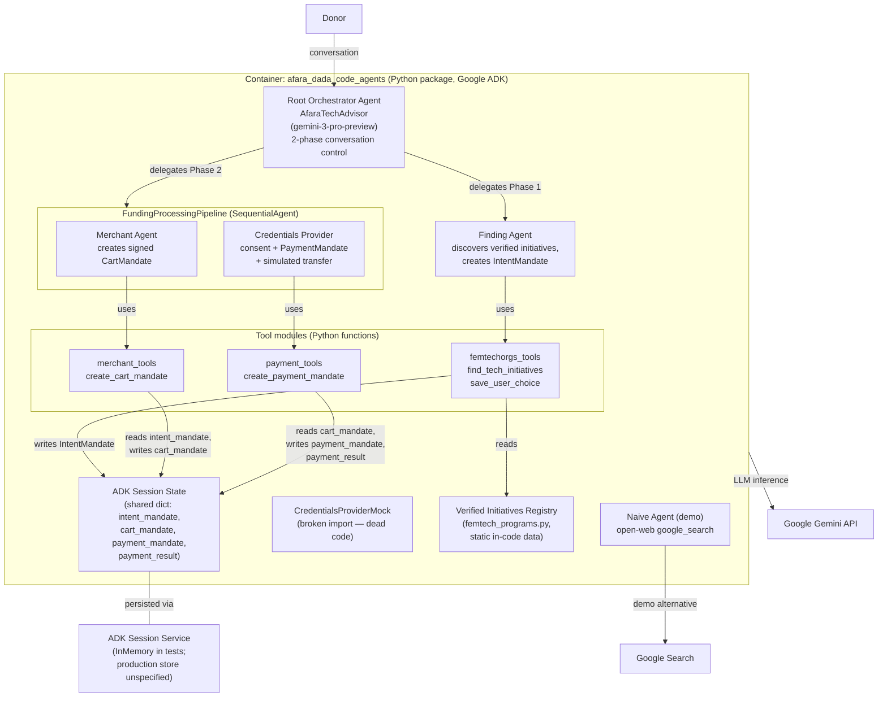

---
blueprint:
  type: c4-container
  id: art_c4-container
  version: 1
  status: in_review
  inputs:
    artifacts:
      - { id: art_c4-context, version: 1 }
  evidence:
    - "afara-dada-code-agents/femtech_empowerment_funding_advisor/agent.py — root_agent 'AfaraTechAdvisor' with sub_agents [finding_agent, FundingProcessingPipeline]"
    - "agent.py:14-21 — FundingProcessingPipeline SequentialAgent(merchant_agent, credentials_provider)"
    - "tools/femtechorgs_tools.py, tools/merchant_tools.py, tools/payment_tools.py — FunctionTools reading/writing tool_context.state"
    - "data/femtech_programs.py — static curated registry"
    - "scripts/test_merchant.py — InMemorySessionService + Runner harness"
    - "credentials_provider/agent_mock.py — mock payment agent (broken 'charity_advisor' import)"
    - "Naive_Agent/agent.py — google_search tool"
  guesses:
    - "Session/state service: only InMemorySessionService appears (in the test script); the production session store is assumed to be ADK's database-backed service on Agent Engine, but the repo is silent (see Q-05)."
    - "The mock credentials provider is listed as a component even though it cannot currently be imported (see Q-04)."
---

# C4 Container — Afara Dada Code

## Containers and responsibilities

| Container / component | Kind | Responsibility |
|---|---|---|
| `afara_dada_code_agents` (package `femtech_empowerment_funding_advisor`) | Deployable Python package | The whole agent application; installable via `setup.py`, run on Google ADK. |
| Root Orchestrator Agent (`agent.py:root_agent`) | ADK Agent | User-facing conversation; enforces the two-phase flow (discovery → execution) and delegates to the Finding Agent and the FundingProcessingPipeline. |
| FundingProcessingPipeline (`agent.py:14-21`) | ADK SequentialAgent | Runs Merchant Agent then Credentials Provider strictly in order after an initiative is selected. |
| Finding Agent (`finding_agent/agent.py`) | ADK Agent | Trust verification layer: presents curated initiatives with trust metrics, then creates the IntentMandate when the donor decides. |
| Merchant Agent (`merchant_agent/agent.py`) | ADK Agent | Contract creator: converts a valid, unexpired IntentMandate into a W3C PaymentRequest-compliant, signed CartMandate. |
| Credentials Provider (`credentials_provider/agent.py`) | ADK Agent | Payment processor: presents the offer, waits for explicit donor confirmation, creates the PaymentMandate and the simulated transfer. |
| Tool modules (`tools/*.py`) | Python async functions | All side effects: data lookup, validation, mandate construction (AP2 Pydantic models), signature generation, state writes. Agents themselves only converse and call tools. |
| Verified Initiatives Registry (`data/femtech_programs.py`) | Static data | Curated list of 5 organizations across 3 regions with trust metrics; the system's "trusted data layer". |
| ADK Session State | Shared state (dict) | The handoff mechanism between agents: `intent_mandate`, `cart_mandate`, `payment_mandate`, `payment_result` keys. |
| ADK Session Service | External to the package | Persists session state; only `InMemorySessionService` appears in code (`scripts/test_merchant.py`). |
| Naive Agent (`Naive_Agent/agent.py`) | ADK Agent | Demo contrast: open-web research without the trust layer. |
| CredentialsProviderMock (`credentials_provider/agent_mock.py`) | ADK Agent (dead code) | Auto-approving payment agent for tests; currently unimportable due to stale `charity_advisor` import. |

## Communication notes

- Donor ↔ Root Orchestrator is a multi-turn natural-language conversation; all control flow between agents (phase transitions, pipeline ordering) is expressed via ADK agent instructions and `SequentialAgent` composition, not code.
- Agent ↔ tools is in-process function invocation through ADK `FunctionTool`, with `tool_context.state` as the only inter-agent data bus — there is no direct agent-to-agent API.
- All four conversational agents call the Gemini API (`gemini-3-pro-preview`) for every turn; the tools are deterministic Python and do not call external services.
- The test harness (`scripts/test_merchant.py`) drives a single agent directly with a `Runner` and seeds state via `InMemorySessionService`, simulating the Finding Agent's output.
