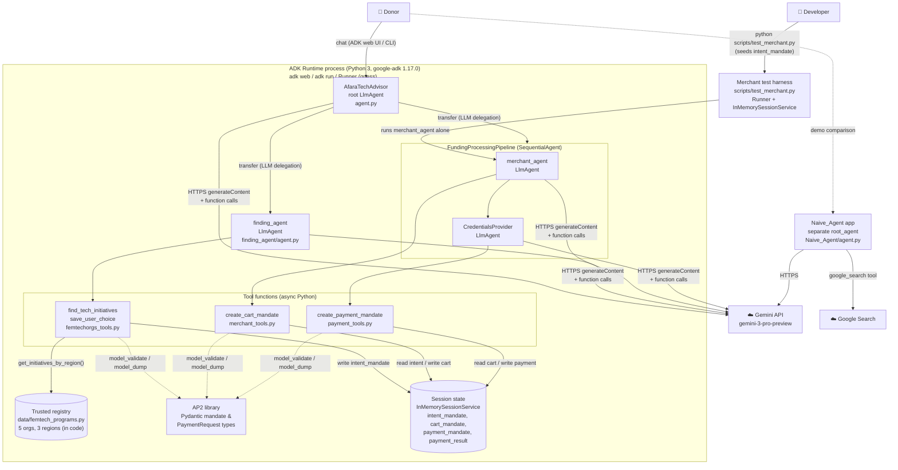

---
blueprint:
  type: c4-container
  id: art_c4-container
  version: 1
  status: in_review
  inputs:
    artifacts:
      - { id: art_c4-context, version: 1 }
  evidence:
    - "afara-dada-code-agents/femtech_empowerment_funding_advisor/agent.py: root_agent (LlmAgent) with sub_agents finding_agent and FundingProcessingPipeline (SequentialAgent of merchant_agent, credentials_provider)"
    - "afara-dada-code-agents/femtech_empowerment_funding_advisor/tools/*.py: tool functions read/write tool_context.state keys intent_mandate, cart_mandate, payment_mandate, payment_result"
    - "afara-dada-code-agents/femtech_empowerment_funding_advisor/data/femtech_programs.py: in-process registry"
    - "afara-dada-code-agents/femtech_empowerment_funding_advisor/*/__init__.py: each sub-package exports root_agent (independently loadable agent apps)"
    - "afara-dada-code-agents/scripts/test_merchant.py: Runner + InMemorySessionService harness"
    - "requirements.txt: google-adk 1.17.0, google-genai, AP2 library, python-dotenv"
  guesses:
    - "The production entry point is ADK's dev server or CLI (adk web / adk run) loading femtech_empowerment_funding_advisor.agent.root_agent; no server code exists in repo (see Q-05)"
    - "Sessions are in-memory (ADK default for adk web/run and the test script); nothing configures a persistent session service (see Q-05)"
    - "Next user turn after the Credentials Provider's consent question is routed back to the root agent, because ADK does not resume a turn inside a SequentialAgent (see Q-02)"
---

# C4 Level 2: Containers

## Containers and responsibilities

| Container | Technology | Responsibility | Source |
|-----------|-----------|----------------|--------|
| **ADK Runtime process** | Python, google-adk 1.17.0, google-genai 1.52.0 | Hosts the agent tree, sends each user turn to the active agent, runs tool calls and keeps the session. | `requirements.txt`, `agent.py` |
| AfaraTechAdvisor *(component)* | ADK `Agent` (LlmAgent) | Talks to the donor and moves between the two phases. Hands discovery to `finding_agent` and execution to the pipeline. | `agent.py:26-88` |
| finding_agent *(component)* | LlmAgent + 2 FunctionTools | Finds initiatives through the trusted tool only, presents trust metrics and creates the IntentMandate. | `finding_agent/agent.py` |
| FundingProcessingPipeline *(component)* | ADK `SequentialAgent` | Runs merchant_agent and then CredentialsProvider in a fixed order. | `agent.py:14-21` |
| merchant_agent *(component)* | LlmAgent + `create_cart_mandate` | Checks that the intent has not expired, builds the W3C PaymentRequest CartMandate and the simulated signature. | `merchant_agent/agent.py`, `tools/merchant_tools.py` |
| CredentialsProvider *(component)* | LlmAgent + `create_payment_mandate` | Asks for consent (prompt only), checks cart expiry, creates the PaymentMandate and simulates the transfer. | `credentials_provider/agent.py`, `tools/payment_tools.py` |
| **Trusted registry** | Python dict in a module | Curated list of vetted organisations by region. Read-only, in memory. | `data/femtech_programs.py` |
| **Session state** | ADK session state (in-memory) | Carries handoffs between agents and is the audit chain of mandates. Lost when the process restarts. | `tools/*.py`, `scripts/test_merchant.py:26` |
| AP2 library | Python package from GitHub `@main` | Schema types for IntentMandate, CartMandate, PaymentMandate and the W3C PaymentRequest. | `requirements.txt:3` |
| **Naive_Agent app** | LlmAgent + `google_search` | Baseline agent: unverified open-web research, with no funding ability. | `Naive_Agent/agent.py` |
| **Merchant test harness** | Python script, ADK `Runner` | Manual integration test. Seeds an IntentMandate into state, runs merchant_agent on its own against live Gemini and prints the resulting cart. | `scripts/test_merchant.py` |
| Mock Credentials Provider *(unused)* | LlmAgent | Version without confirmation, meant for automated tests. It cannot be imported: the module path is wrong. | `credentials_provider/agent_mock.py` |

## Communication

- **Between agents** (in process): the ADK LLM-driven `transfer_to_agent` from root to its two children, and the fixed order inside the `SequentialAgent`. The agents pass **no direct messages**. All handoff data goes through `tool_context.state`.
- **Agent to LLM**: HTTPS to the Gemini API through google-genai, authenticated with `GOOGLE_API_KEY` from `.env`.
- **Donor to system**: chat turns through whatever ADK front end is running. The repo has no HTTP API, auth layer or UI code of its own.
- Each sub-package exports `root_agent`, so the ADK tooling can also load `finding_agent`, `merchant_agent` and `credentials_provider` as separate apps.
