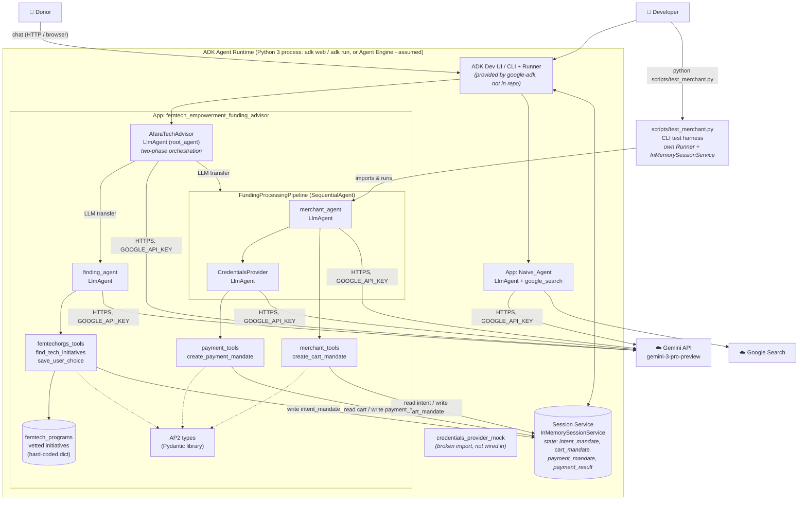

---
blueprint:
  type: c4-container
  id: art_c4-container
  version: 1
  status: in_review
  inputs:
    artifacts:
      - { id: art_c4-context, version: 1 }
  evidence:
    - "afara-dada-code-agents/femtech_empowerment_funding_advisor/agent.py: root_agent (LlmAgent) with sub_agents finding_agent and FundingProcessingPipeline (SequentialAgent of merchant_agent, credentials_provider)"
    - "afara-dada-code-agents/femtech_empowerment_funding_advisor/{finding_agent,merchant_agent,credentials_provider}/__init__.py: each exposes root_agent, so each can be loaded as its own ADK app"
    - "afara-dada-code-agents/femtech_empowerment_funding_advisor/Naive_Agent/__init__.py and agent.py: separate root_agent using google_search"
    - "afara-dada-code-agents/femtech_empowerment_funding_advisor/tools/*.py: FunctionTools reading/writing tool_context.state"
    - "afara-dada-code-agents/femtech_empowerment_funding_advisor/data/femtech_programs.py: in-process initiative data"
    - "afara-dada-code-agents/scripts/test_merchant.py: InMemorySessionService + Runner used for testing"
    - "requirements.txt: google-adk 1.17.0, google-cloud-aiplatform[adk,agent-engines], AP2 from git"
  guesses:
    - "In development the agents are hosted by the ADK CLI/dev server (`adk web` / `adk run`), which provides the Runner, the chat UI and an in-memory session service; no launch script is in the repo (see Q-05)"
    - "A production deployment would use Vertex AI Agent Engine (because of the agent-engines extra) with a managed session service (see Q-05)"
---

# C4 Level 2: Containers

## Containers and responsibilities

| Container / part | Technology | Responsibility | Source |
|------------------|------------|----------------|--------|
| ADK Agent Runtime | Python process running google-adk 1.17.0 (dev UI / CLI / Runner) | Hosts the agents, sends chat turns to the right agent, runs the tool-call loop, owns session state. | `requirements.txt:1`, `scripts/test_merchant.py:16-17,78-91` |
| Session Service | ADK `InMemorySessionService` (in the test; assumed for the dev server too) | The only shared memory between agents. Lost when the process restarts. | `scripts/test_merchant.py:26,58-63` |
| AfaraTechAdvisor (root agent) | ADK `Agent` (LLM) | Donor-facing persona. Hands Phase 1 to `finding_agent` and Phase 2 to the pipeline, then summarises. | `agent.py:26-88` |
| finding_agent | ADK `Agent` + 2 FunctionTools | Discovery from the trusted data, Q&A, input validation, IntentMandate creation. | `finding_agent/agent.py`, `tools/femtechorgs_tools.py` |
| FundingProcessingPipeline | ADK `SequentialAgent` | Runs merchant then credentials in a fixed order. | `agent.py:14-21` |
| merchant_agent | ADK `Agent` + FunctionTool | Checks the intent and its expiry, builds the W3C/AP2 CartMandate and its simulated signature. | `merchant_agent/agent.py`, `tools/merchant_tools.py` |
| CredentialsProvider | ADK `Agent` + FunctionTool | Consent dialogue (prompt only), checks cart expiry, creates the PaymentMandate, simulates the transfer. | `credentials_provider/agent.py`, `tools/payment_tools.py` |
| Trusted data module | Python dict in a function | Five vetted initiatives in three regions. | `data/femtech_programs.py` |
| Naive_Agent | ADK `Agent` + built-in `google_search` | Separate baseline app with no trust layer. | `Naive_Agent/agent.py` |
| credentials_provider_mock | ADK `Agent` | Meant for auto-approve testing. Imports a non-existent `charity_advisor` package and is not used anywhere. | `credentials_provider/agent_mock.py` |
| test_merchant.py | Python asyncio script | Seeds an IntentMandate, runs the merchant agent alone, prints the cart. | `scripts/test_merchant.py` |
| Gemini API (external) | Google Gen AI SDK 1.52.0 | LLM for all agents. | `requirements.txt:5`, `model=` in each agent |

## Communication

- **Within the process only.** All agents and tools run in a single Python process. There are no network calls between
  agents: the root agent and finding agent hand off with ADK *agent transfer*, and the pipeline uses SequentialAgent
  ordering. Data passes **only through session state**. Tools read and write `tool_context.state[...]` as JSON-friendly
  dicts made by `model_dump(mode='json')` and re-validated with `model_validate`.
- **Outbound:** each agent turn calls Gemini over HTTPS. The Naive agent also uses Google Search grounding.
- **Packaging:** the package uses absolute imports such as `femtech_empowerment_funding_advisor.tools...`, so it
  needs `pip install -e .` from `afara-dada-code-agents/` (`setup.py`, `README.md:36`).
- **Configuration:** `.env` loaded by python-dotenv (the test script loads `afara-dada-code-agents/.env`).
  `GOOGLE_API_KEY` is the only documented setting (`README.md:42-44`).
