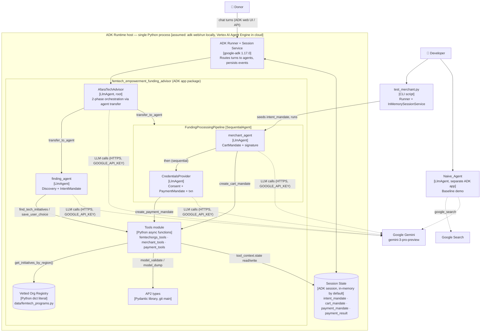

---
blueprint:
  type: c4-container
  id: art_c4-container
  version: 1
  status: in_review
  inputs:
    artifacts:
      - { id: art_c4-context, version: 1 }
  evidence:
    - "afara-dada-code-agents/femtech_empowerment_funding_advisor/agent.py:14-88: root LlmAgent with sub_agents [finding_agent, FundingProcessingPipeline(SequentialAgent: merchant_agent, credentials_provider)]"
    - "afara-dada-code-agents/femtech_empowerment_funding_advisor/tools/*.py: tools read/write tool_context.state keys intent_mandate, cart_mandate, payment_mandate, payment_result"
    - "afara-dada-code-agents/femtech_empowerment_funding_advisor/data/femtech_programs.py: in-process registry"
    - "afara-dada-code-agents/scripts/test_merchant.py:16-17,26,78-82: Runner + InMemorySessionService usage"
    - "afara-dada-code-agents/femtech_empowerment_funding_advisor/*/__init__.py: each sub-package exports root_agent"
    - "requirements.txt: google-adk 1.17.0, AP2 library, google-cloud-aiplatform[adk,agent-engines]"
  guesses:
    - "The whole system runs as a single Python process (one ADK app) hosted by ADK dev tooling or Vertex AI Agent Engine; no Dockerfile or deploy config exists (see Q-10)"
    - "Session state is held by the ADK session service: in-memory for local runs, possibly a managed service when deployed (see Q-10)"
---

# C4 Level 2: Containers

## Containers and responsibilities

| Container / component | Technology | Responsibility | Code |
|---|---|---|---|
| ADK Runner + Session Service | google-adk 1.17.0 | Takes donor messages, sends each turn to the active agent, stores events and session state. Not configured anywhere in the repo except the test script. | `scripts/test_merchant.py:26,78-82` |
| Session State | ADK session (dict) | Shared memory between agents. It is the only place the IntentMandate, CartMandate, PaymentMandate and payment result are stored. | `tools/femtechorgs_tools.py:145`, `tools/merchant_tools.py:165`, `tools/payment_tools.py:146-147` |
| AfaraTechAdvisor | LlmAgent (Gemini) | Root conversational agent. Hands off to the finding agent for discovery and to the pipeline once an intent exists, then summarises the result. Has no tools of its own. | `agent.py:26-88` |
| finding_agent | LlmAgent + 2 FunctionTools | Looks up the registry by region, presents trust metrics, validates the choice and writes the IntentMandate. | `finding_agent/agent.py`, `tools/femtechorgs_tools.py` |
| FundingProcessingPipeline | SequentialAgent | Runs the merchant agent and then the credentials provider, in a fixed order. | `agent.py:14-21` |
| merchant_agent | LlmAgent + FunctionTool | Validates the intent (schema and expiry), builds the W3C PaymentRequest CartMandate (15-minute expiry), signs it and writes it to state. | `merchant_agent/agent.py`, `tools/merchant_tools.py` |
| CredentialsProvider | LlmAgent + FunctionTool | Asks the donor for explicit consent (prompt-level only), validates the cart, builds the PaymentMandate and simulates the transfer. | `credentials_provider/agent.py`, `tools/payment_tools.py` |
| Tools module | Python async functions | Deterministic business logic: validation, mandate construction, hashing and ids, reading and writing state. | `tools/*.py` |
| Vetted Org Registry | Python dict literal | Five organisations across three regions, plus an `africa` wildcard. Read-only. | `data/femtech_programs.py` |
| AP2 types | Pydantic library (git main) | Schemas for IntentMandate, CartMandate, PaymentMandate and the W3C PaymentRequest/Response. | `requirements.txt:3` |
| Naive_Agent | LlmAgent + google_search | Separate baseline agent for the demo, with no trust layer. | `Naive_Agent/agent.py` |
| test_merchant.py | CLI script | Manual check of the merchant step with a pre-filled IntentMandate. Calls the live LLM. | `scripts/test_merchant.py` |
| (unused) credentials_provider_mock | LlmAgent | Auto-approving variant meant for tests. It cannot be imported (`charity_advisor` package does not exist). | `credentials_provider/agent_mock.py:7` |

## Communication notes

- **Agent-to-agent handoff** uses ADK's LLM-driven `transfer_to_agent`, which comes from `sub_agents` (`agent.py:84-87`). Agents do not pass messages to each other. Data moves between them only through **session state keys**, plus the conversation history the next LLM sees.
- **Inside the pipeline** the order is fixed (SequentialAgent). The credentials provider's two-turn consent pattern (`credentials_provider/agent.py:33-39`) has to survive a turn boundary in the middle of the sequence. How ADK resumes there is not shown in the code (see the NFR document, B-09).
- **Everything runs in one process.** There are no network hops between the containers inside the runtime box. The only remote calls are to Gemini (and to Google Search, for the Naive agent).
- **Packaging.** `setup.py` uses `find_packages()` and is installed editable. The ADK app directory is `femtech_empowerment_funding_advisor`, and its `agent.py` exports `root_agent`.
