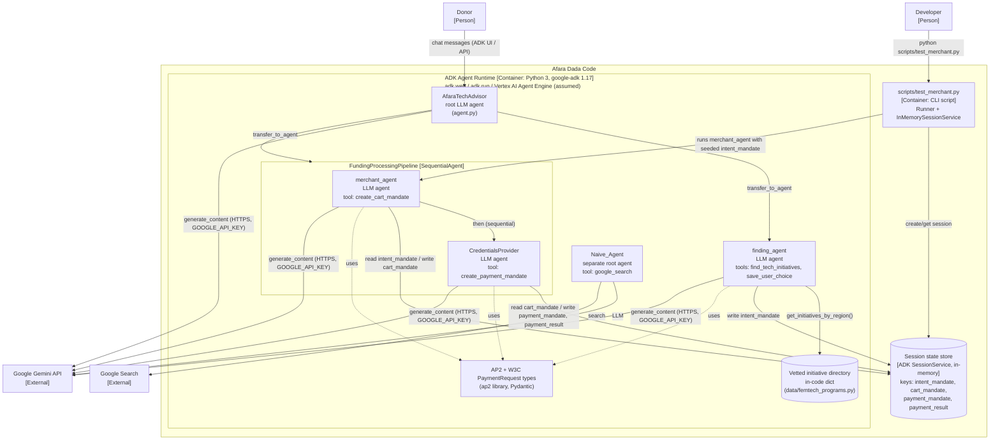

---
blueprint:
  type: c4-container
  id: art_c4-container
  version: 1
  status: in_review
  inputs:
    artifacts:
      - { id: art_c4-context, version: 1 }
  evidence:
    - "afara-dada-code-agents/femtech_empowerment_funding_advisor/agent.py: root_agent with sub_agents [finding_agent, FundingProcessingPipeline(SequentialAgent: merchant_agent, credentials_provider)]"
    - "afara-dada-code-agents/femtech_empowerment_funding_advisor/*/__init__.py: each sub-package exports root_agent, the ADK convention for 'adk web' / 'adk run' discovery"
    - "afara-dada-code-agents/femtech_empowerment_funding_advisor/tools/*.py: tool functions read and write tool_context.state"
    - "afara-dada-code-agents/femtech_empowerment_funding_advisor/data/femtech_programs.py: in-process dict acting as the 'database'"
    - "afara-dada-code-agents/scripts/test_merchant.py: Runner + InMemorySessionService, the only explicit runtime wiring in the repo"
    - "requirements.txt: google-adk, google-cloud-aiplatform[adk,agent-engines], AP2, google-genai"
  guesses:
    - "In normal use the ADK CLI/web server ('adk web') or Vertex AI Agent Engine is the runtime container. Neither is configured in the repo (see Q-05)"
    - "Session state uses the runtime's default session service, which is in-memory for adk web. No database is provisioned (see Q-05)"
---

# Afara Dada Code – Containers (C4 level 2)

## Containers and responsibilities

| Container / component | Technology | Responsibility | Source |
|-----------------------|-----------|----------------|--------|
| ADK Agent Runtime | Python, `google-adk` 1.17.0. Host assumed to be `adk web` or Vertex AI Agent Engine. | Hosts the agent tree, routes the donor's turns, and runs the tool calls. | `requirements.txt:1-2` |
| AfaraTechAdvisor (root) | ADK `Agent` (LLM) | Persona and two-phase orchestration. Hands off to the finding agent, then to the pipeline. | `agent.py:26-88` |
| finding_agent | ADK `Agent` + 2 `FunctionTool`s | Discovers vetted initiatives, validates the choice, writes the IntentMandate. | `finding_agent/agent.py`, `tools/femtechorgs_tools.py` |
| FundingProcessingPipeline | ADK `SequentialAgent` | Runs the merchant agent, then the credentials provider. | `agent.py:14-21` |
| merchant_agent | ADK `Agent` + `FunctionTool` | Turns an IntentMandate into a signed CartMandate (15-minute expiry). | `merchant_agent/agent.py`, `tools/merchant_tools.py` |
| CredentialsProvider | ADK `Agent` + `FunctionTool` | Asks for consent (prompt only), creates the PaymentMandate, simulates the transfer. | `credentials_provider/agent.py`, `tools/payment_tools.py` |
| Vetted initiative directory | Python dict in a module | The "Trusted Data Layer": 5 initiatives in 3 regions. Read-only. | `data/femtech_programs.py` |
| AP2 types | `ap2` library from git `main` | Pydantic models for IntentMandate, CartMandate, PaymentMandate and the W3C PaymentRequest. | `requirements.txt:3` |
| Session state store | ADK `SessionService` (in-memory in the code) | The shared blackboard that hands mandates from agent to agent. | `tools/*.py` (`tool_context.state`), `scripts/test_merchant.py:26` |
| Naive_Agent | ADK `Agent` + `google_search` | A separate demo root agent for the "before" situation. Not part of the main tree. | `Naive_Agent/agent.py` |
| test_merchant.py | CLI script | Developer test of the merchant agent alone. Its import is currently broken (see NFR doc). | `scripts/test_merchant.py` |
| agent_mock.py (not shown) | ADK `Agent` | A credentials provider that auto-approves. Not wired in, and its import is broken. | `credentials_provider/agent_mock.py` |

## Communication

- **Agent → agent:** ADK agent transfer, which the LLM decides on from sub-agent descriptions and the root
  instruction. Inside the pipeline the order is fixed (`SequentialAgent`).
- **Agent → agent data handoff:** only through session state keys holding JSON-serialisable dicts. Each tool
  re-validates the upstream dict into an AP2 Pydantic model before using it.
- **Agent → Gemini:** HTTPS via `google-genai`. The API key comes from `.env` (`GOOGLE_API_KEY`).
- **No network I/O** to initiatives or payment providers. Settlement is simulated in process.
- Every ADK sub-package exports `root_agent`. This lets `adk web` load `finding_agent`, `merchant_agent`,
  `credentials_provider` and `Naive_Agent` as standalone apps, as well as the top-level advisor.
