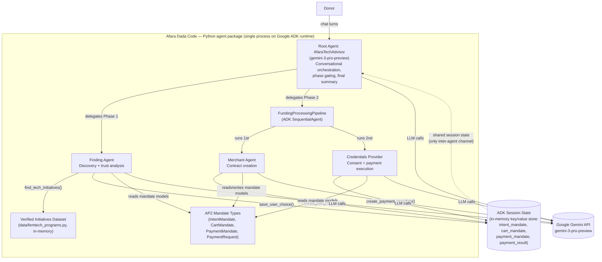

---
blueprint:
  type: c4-container
  id: art_c4-container
  version: 1
  status: in_review
  inputs:
    artifacts:
      - { id: art_c4-context, version: 1 }
  evidence:
    - "afara-dada-code-agents/femtech_empowerment_funding_advisor/agent.py — root agent + SequentialAgent pipeline composition"
    - "afara-dada-code-agents/femtech_empowerment_funding_advisor/tools/femtechorgs_tools.py, merchant_tools.py, payment_tools.py — tool implementations"
    - "afara-dada-code-agents/femtech_empowerment_funding_advisor/data/femtech_programs.py — in-process curated dataset"
    - "afara-dada-code-agents/scripts/test_merchant.py — Runner + InMemorySessionService usage, showing state flow"
    - "requirements.txt — google-adk 1.17.0, google-cloud-aiplatform[adk,agent-engines], AP2, google-genai"
  guesses:
    - "Everything runs inside one Python process on the ADK runtime; the 'containers' below are module-level components of a single deployable (see Q-06)"
    - "Session state is in-memory only; no database service is configured anywhere in the repo (see Q-09)"
---

# C4 Container — Afara Dada Code

## Containers and responsibilities

| Container | Kind | Responsibility |
|---|---|---|
| Root Agent (`AfaraTechAdvisor`) | ADK Agent (`agent.py:26-88`) | Donor-facing conversation; two-phase orchestration; enforces "no execution without IntentMandate"; summarizes the transaction. |
| FundingProcessingPipeline | ADK `SequentialAgent` (`agent.py:14-21`) | Runs Merchant Agent then Credentials Provider in strict order once an initiative is selected. |
| Finding Agent | ADK Agent (`finding_agent/agent.py`) | Discovery of verified initiatives by region; presents trust metrics; creates the IntentMandate via `save_user_choice`. |
| Merchant Agent | ADK Agent (`merchant_agent/agent.py`) | Reads the IntentMandate, validates expiry, builds a W3C PaymentRequest and signed CartMandate via `create_cart_mandate`. |
| Credentials Provider | ADK Agent (`credentials_provider/agent.py`) | Reads the CartMandate, gets explicit donor consent (two-turn pattern), creates the PaymentMandate, simulates the transfer via `create_payment_mandate`. |
| Verified Initiatives Dataset | In-process module (`data/femtech_programs.py`) | Curated list of 5 organizations across 3 regions with trust metrics; the system's "trusted data layer". |
| AP2 Mandate Types | Library (pip, `requirements.txt:3`) | Pydantic models for the three-credential chain and W3C PaymentRequest structures. |
| ADK Session State | Runtime service (in-memory) | The only inter-agent communication channel; carries `intent_mandate`, `cart_mandate`, `payment_mandate`, `payment_result`. |
| Google Gemini API | External SaaS | LLM reasoning for all four agents (tool calling, delegation, conversation). |
| Naive Agent | ADK Agent (comparison demo, `Naive_Agent/agent.py`) | Open-web Google Search baseline showing discovery without a trust layer. |
| Test harness | Script (`scripts/test_merchant.py`) | Simulates Finding Agent output in state and drives the Merchant Agent end to end via `Runner` + `InMemorySessionService`. |

## Notes

- The three specialist agents never call each other directly; they coordinate exclusively through ADK session state and the root/pipeline delegation structure. Each tool reads its predecessor's mandate from state (`tool_context.state.get(...)`) and fails loudly if it is missing.
- Each agent has exactly one or two narrow tools, mirroring the separation-of-duties rules in their instructions (see ADR-0001).
- There is no database, queue, or web service container: the whole system is one Python package (`setup.py`, `find_packages()`), and the only I/O boundary is the Gemini API.
