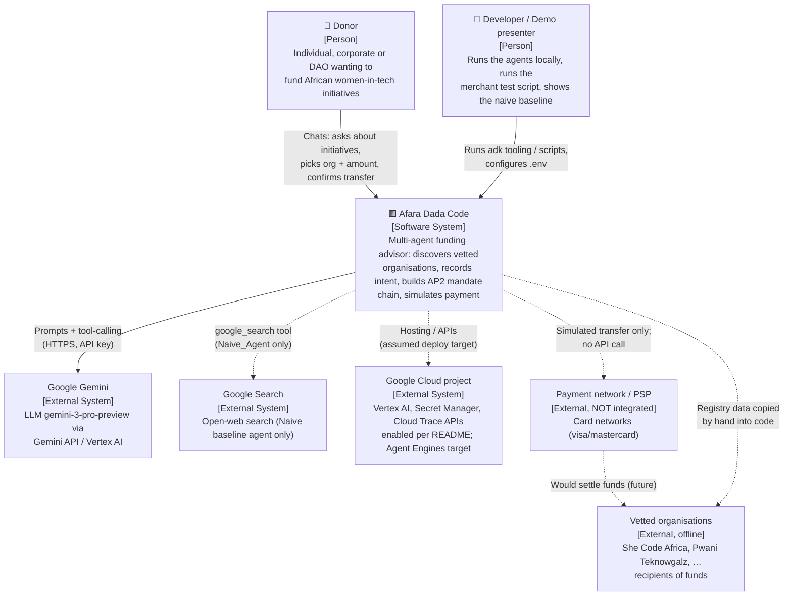

---
blueprint:
  type: c4-context
  id: art_c4-context
  version: 1
  status: in_review
  inputs:
    artifacts:
      - { id: art_requirements, version: 1 }
  evidence:
    - "README.md:15: donors (individuals, corporates, DAOs) fund verified organisations via the agent"
    - "README.md:38-43: Google Cloud project, aiplatform/secretmanager/cloudtrace APIs, GOOGLE_API_KEY"
    - "afara-dada-code-agents/femtech_empowerment_funding_advisor/*/agent.py: all agents use model gemini-3-pro-preview"
    - "afara-dada-code-agents/femtech_empowerment_funding_advisor/Naive_Agent/agent.py:15,28: google_search tool (baseline only)"
    - "afara-dada-code-agents/femtech_empowerment_funding_advisor/tools/payment_tools.py:128-143: payment network is simulated, no outbound call"
  guesses:
    - "Gemini is reached through the Gemini API using GOOGLE_API_KEY locally, and through Vertex AI when deployed (see Q-10)"
    - "No real payment network or organisation-side system is integrated; they appear only as future or offline relationships (see Q-01, Q-06)"
---

# C4 Level 1: System context

## Notes

- **Users.** The main user is the **Donor**, who talks only to the root agent "Afara Tech" (`agent.py:24-31`). The **Developer / presenter** role is inferred from the README Quick Start, the manual `scripts/test_merchant.py`, and the Naive agent, whose docstring calls it a demo of the "Before" state (`Naive_Agent/agent.py:1-12`).
- **Gemini** is the only external system called at runtime by the main flow. Every agent decision (routing, extracting parameters, choosing to call a tool, confirming consent) is made by the LLM.
- **Google Search** is used only by the separate `Naive_Agent`. The main finding agent is told explicitly not to search the open web (`finding_agent/agent.py:22`).
- **Google Cloud.** The README enables `aiplatform`, `secretmanager` and `cloudtrace` (`README.md:40`), and `requirements.txt:2` pulls `google-cloud-aiplatform[adk,agent-engines]`. No code uses Secret Manager or Cloud Trace yet, so the relationship is shown dashed.
- **Payment network and organisations.** The cart offers CARD (visa/mastercard), but no payment provider is called; the transfer is a hash-generated `txn_…` id with `simulation: true`. The organisations do not connect to the system. Their data is a hard-coded copy (`data/femtech_programs.py`), and their "signature" is made by the system itself (`merchant_tools.py:54-74`).
- **AP2** (`requirements.txt:3`) is a library linked into the process, not a remote system, so it appears at container level instead.
