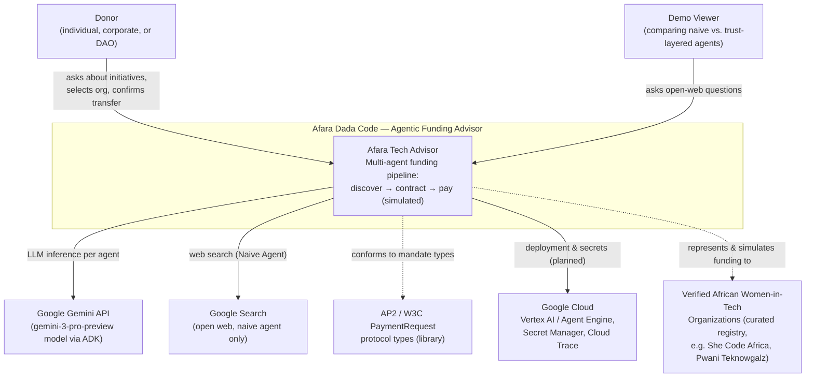

---
blueprint:
  type: c4-context
  id: art_c4-context
  version: 1
  status: in_review
  inputs:
    artifacts:
      - { id: art_requirements, version: 1 }
  evidence:
    - "README.md:15-17 — donors (individuals, corporates, DAOs) fund verified female empowerment organizations"
    - "agent.py — root agent 'AfaraTechAdvisor' backed by gemini-3-pro-preview via Google ADK"
    - "Naive_Agent/agent.py:14-15,28 — google_search tool against the open web"
    - "requirements.txt — google-adk, google-genai, google-cloud-aiplatform[agent-engines], AP2"
    - "README.md:38-43 — Google Cloud project, Secret Manager, GOOGLE_API_KEY in .env"
  guesses:
    - "The verified organizations are modeled as an external actor even though today they are a static in-code list; in the product vision they are real counterparties receiving funds (see Q-03)."
    - "No payment processor external system exists yet because transfers are simulated (see Q-01)."
    - "The AP2 library is a code dependency rather than an external system; it is shown as a protocol standard the system conforms to."
---

# C4 Context — Afara Dada Code

## Notes

- **Donor** is the primary user: they converse with the root orchestrator, browse verified initiatives, pick an organization and amount, and give the final confirmation before the (simulated) transfer.
- **Demo Viewer** reflects the repository's demo posture: a deliberately naive open-web agent (`Naive_Agent/agent.py`) is kept alongside the pipeline to contrast unverified research with the trust-layered flow.
- **Google Gemini API** is the only runtime external dependency actually exercised by the code: every agent call uses `gemini-3-pro-preview` through Google ADK.
- **Google Cloud (Vertex AI / Agent Engine, Secret Manager)** is enabled per the README but no deployment code exists in the repo; it is a planned target, not a live integration (Q-05).
- **Verified organizations** are currently a hardcoded curated dataset (`data/femtech_programs.py`) rather than a live registry; the dashed arrow marks that the "funding to organization" link is simulated end to end.
- **AP2** appears as a protocol the system conforms to (its Pydantic models define IntentMandate, CartMandate, PaymentMandate), not a running external system.
- There is **no real payment network** in the current system: `payment_tools.py` marks every result `"simulation": true`.
