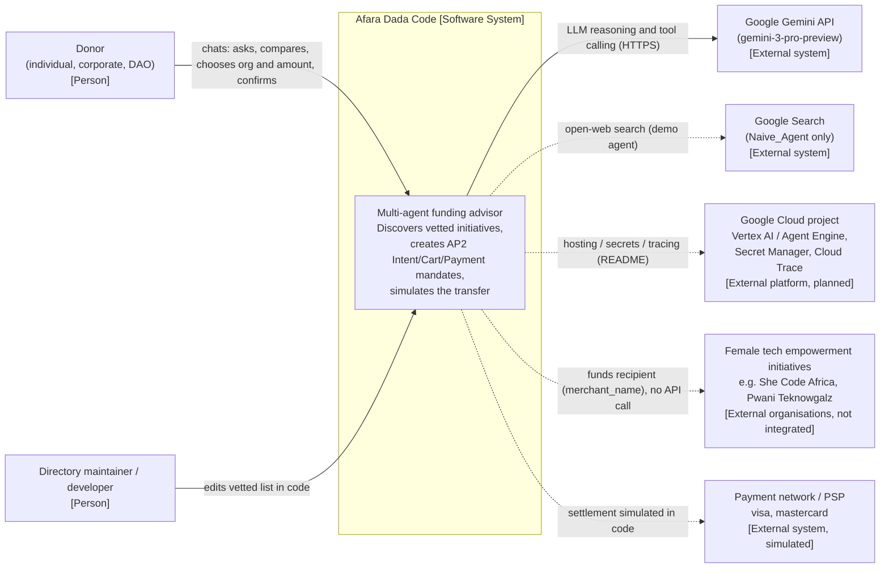

---
blueprint:
  type: c4-context
  id: art_c4-context
  version: 1
  status: in_review
  inputs:
    artifacts:
      - { id: art_requirements, version: 1 }
  evidence:
    - "afara-dada-code-agents/femtech_empowerment_funding_advisor/agent.py: root_agent 'AfaraTechAdvisor' is what users interact with directly (comment on lines 24-25)"
    - "All agent.py files: model='gemini-3-pro-preview', so every agent calls the Gemini API"
    - "afara-dada-code-agents/femtech_empowerment_funding_advisor/Naive_Agent/agent.py: google_search tool calls Google Search"
    - "README.md:38-44: Google Cloud project, aiplatform/secretmanager/cloudtrace APIs, GOOGLE_API_KEY"
    - "afara-dada-code-agents/femtech_empowerment_funding_advisor/tools/payment_tools.py:133-143: settlement is simulated, so no payment network is called"
  guesses:
    - "The Gemini API is reached either through the Google AI API key or through Vertex AI. The code does not say which (see Q-05)"
    - "Secret Manager and Cloud Trace are enabled in the README but nothing in the code uses them. They are shown as planned, not current (see Q-05)"
    - "Initiatives and payment networks are external actors in the business sense only. The system makes no calls to them today (see Q-02)"
---

# Afara Dada Code – System Context (C4 level 1)

Solid lines are interactions that happen in the code today. Dashed lines are implied or planned interactions with no
implementation.

## Actors and external systems

| Element | Kind | Interaction | Evidence |
|---------|------|-------------|----------|
| Donor | Person | Talks to the root agent in natural language and confirms the payment. | `agent.py:24-25`, `credentials_provider/agent.py:33-39` |
| Directory maintainer | Person | Edits the hard-coded list of vetted initiatives. No admin UI exists. | `data/femtech_programs.py` (guess) |
| Google Gemini | External LLM | Every agent's reasoning and tool selection. | `model="gemini-3-pro-preview"` in all agents |
| Google Search | External | Built-in ADK `google_search` tool, used only by `Naive_Agent`. | `Naive_Agent/agent.py:15,28` |
| Google Cloud (Vertex AI / Agent Engine, Secret Manager, Cloud Trace) | Platform | Enabled in the README and pulled in as a dependency. No code uses it directly. | `README.md:38-40`, `requirements.txt:2` |
| Initiatives | Organisations | The funds recipient, named in the CartMandate. They take no part at runtime. Their "signature" is generated for them. | `tools/merchant_tools.py:54-74` |
| Payment network | External | Named in the PaymentRequest (visa/mastercard). It is never called, and the transfer is simulated. | `tools/merchant_tools.py:123-129`, `tools/payment_tools.py:133-143` |

## Notes

- The system boundary is a single Python package of ADK agents. The donor reaches it through whatever ADK
  runtime hosts `root_agent`. The repo has no UI or HTTP API of its own (see Q-05).
- From a trust point of view, the only external dependency on the critical path is Gemini. Every decision about
  when to call a payment tool is made by the LLM.
