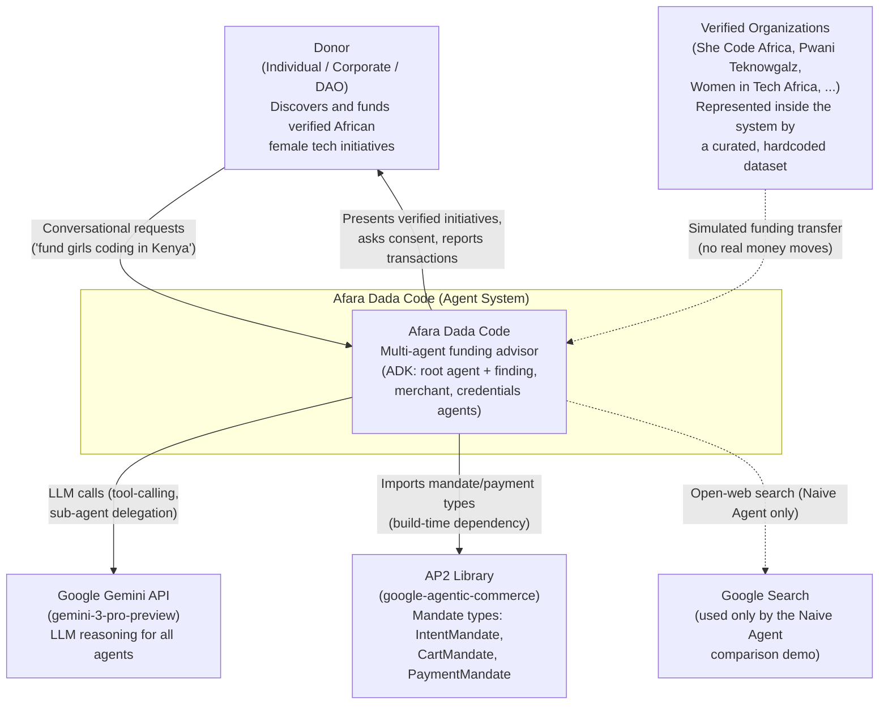

---
blueprint:
  type: c4-context
  id: art_c4-context
  version: 1
  status: in_review
  inputs:
    artifacts:
      - { id: art_requirements, version: 1 }
  evidence:
    - "afara-dada-code-agents/femtech_empowerment_funding_advisor/agent.py — root agent definition (model gemini-3-pro-preview, sub_agents)"
    - "afara-dada-code-agents/femtech_empowerment_funding_advisor/Naive_Agent/agent.py — open-web Google Search baseline agent"
    - "requirements.txt — google-adk, google-genai, AP2, python-dotenv dependencies"
    - "README.md — product framing, donors as individuals/corporates/DAOs, Google Cloud quick start"
  guesses:
    - "No payment network or bank is integrated anywhere; the recipient organization and any PSP are outside the current boundary (see Q-08)"
    - "Google Search is only reachable by the Naive Agent demo, not the main flow (see finding_agent instruction 'Do NOT search the open web')"
---

# C4 Context — Afara Dada Code

## Notes

- **Donor** is the only human actor. The README describes three donor personas: individuals, corporates, and DAOs.
- **Google Gemini API** is the external system every agent depends on for reasoning; all four agents use `model="gemini-3-pro-preview"`. It requires a `GOOGLE_API_KEY` (README quick start).
- **AP2** (`git+https://github.com/google-agentic/AP2.git`) is a build-time library dependency rather than a runtime service, but it defines the system's core vocabulary — the three-credential mandate chain.
- **Google Search** is an external capability used only by the `Naive_Agent`, which exists to demonstrate what the system looks like *without* a trust layer.
- **Verified organizations** are not runtime actors: they appear as data in a hardcoded dataset (`data/femtech_programs.py`), and the "transfer" to them is simulated. There is no external payment processor, bank, or card network in the current system.
- The system boundary is a single deployable Python agent package run on the Google ADK runtime (local dev mode today; Vertex AI Agent Engine is suggested by the README's `gcloud services enable` steps — see Q-06).
