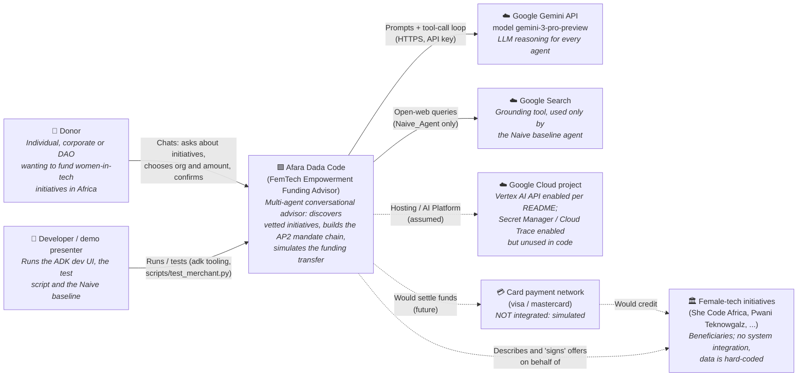

---
blueprint:
  type: c4-context
  id: art_c4-context
  version: 1
  status: in_review
  inputs:
    artifacts:
      - { id: art_requirements, version: 1 }
  evidence:
    - "README.md:15: users are donors (individuals, corporates, DAOs); organisations are the beneficiaries"
    - "README.md:38-44: Google Cloud project, aiplatform API, GOOGLE_API_KEY"
    - "afara-dada-code-agents/femtech_empowerment_funding_advisor/*/agent.py: every agent uses model gemini-3-pro-preview (Gemini API)"
    - "afara-dada-code-agents/femtech_empowerment_funding_advisor/Naive_Agent/agent.py:15,28: google_search tool"
    - "afara-dada-code-agents/femtech_empowerment_funding_advisor/tools/payment_tools.py:128-143: settlement is simulated, so no payment network is called"
    - "afara-dada-code-agents/femtech_empowerment_funding_advisor/data/femtech_programs.py: organisation data is embedded, so there is no external registry"
  guesses:
    - "Gemini is reached through the Google Gen AI SDK with GOOGLE_API_KEY (Gemini Developer API), or alternatively through Vertex AI. The code does not choose; it depends on environment variables (see Q-05)"
    - "Payment networks and the organisations' own systems are future integrations, shown dashed, not current ones (see Q-01)"
    - "A developer/demo presenter is a separate actor who runs the test script and the Naive baseline (see Q-05)"
---

# C4 Level 1: System context

## Notes

- **One real external dependency at runtime.** Gemini is the only external system the funding flow actually calls.
  Every agent decision goes through it, including routing between agents, when to call tools, and the consent dialogue.
  The Naive agent also calls Google Search through ADK's built-in `google_search` tool.
- **No payment integration.** The CartMandate advertises CARD (visa/mastercard), but `create_payment_mandate` only
  makes a simulated token and transaction ID (`payment_tools.py:63-67`, `134-143`). No money moves.
- **Organisations are not actors in the system.** Their "signature" is computed locally by the merchant tool
  (`merchant_tools.py:54-74`), and their data is a Python dict (`data/femtech_programs.py`). The system speaks for
  them but they have no channel into it.
- **AP2** is a library dependency (Pydantic types installed from GitHub), not a remote service.
- **Trust boundary:** donor input (free text) goes straight into LLM prompts. Consent and phase gating depend on the
  LLM following instructions (see `nfr-and-threats.md`).
