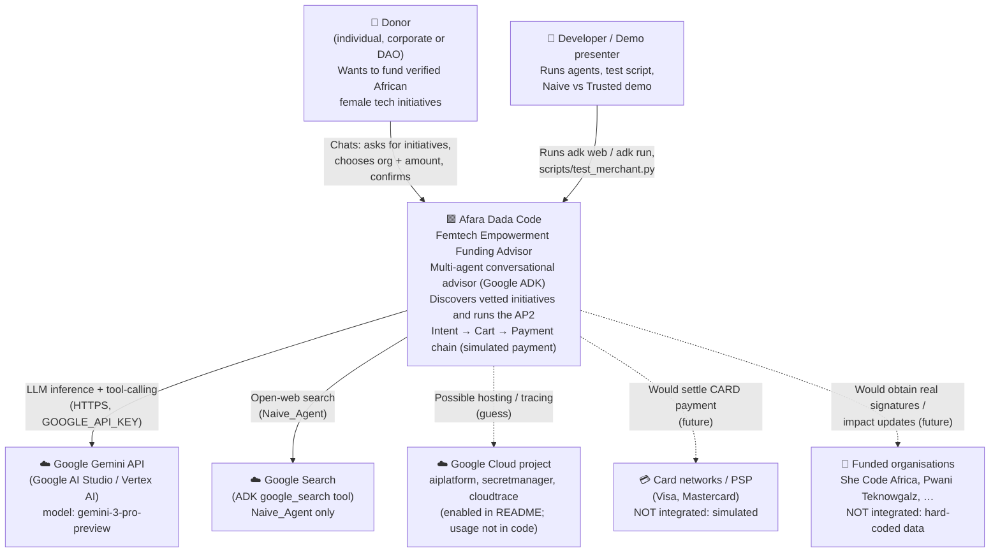

---
blueprint:
  type: c4-context
  id: art_c4-context
  version: 1
  status: in_review
  inputs:
    artifacts:
      - { id: art_requirements, version: 1 }
  evidence:
    - "README.md:15: donors (individuals, corporates, DAOs) fund verified female empowerment organisations via an agentic workflow"
    - "afara-dada-code-agents/femtech_empowerment_funding_advisor/agent.py: model gemini-3-pro-preview used by every agent (Gemini API is the only live external dependency)"
    - "afara-dada-code-agents/femtech_empowerment_funding_advisor/Naive_Agent/agent.py: google_search tool (Google Search grounding)"
    - "afara-dada-code-agents/femtech_empowerment_funding_advisor/tools/payment_tools.py: payment is simulated; no call to any payment network"
    - "README.md:38-43 and requirements.txt:2: Google Cloud project, aiplatform/secretmanager/cloudtrace APIs, GOOGLE_API_KEY"
  guesses:
    - "Donors reach the system through the ADK developer UI/CLI (adk web / adk run); no custom front end exists in the repo (see Q-05)"
    - "Card networks and the funded organisations are represented only as data; they are shown dashed as future integrations (see Q-01, Q-07)"
    - "Secret Manager and Cloud Trace are enabled in the README but not used by any code (see Q-05)"
---

# C4 Level 1: System Context

## Notes

- **The only live external dependency is the Gemini API.** Every agent is an ADK `Agent` with `model="gemini-3-pro-preview"`. Google Search is used only by `Naive_Agent`, the open-web baseline that shows what goes wrong without a trust layer.
- **Nothing reaches a payment system.** `create_payment_mandate` builds an AP2 PaymentMandate and a `payment_result` with `simulation: True`. The payment token is the literal string `simulated_funding_token_AFRICA_TECH`.
- **Funded organisations are data, not participants.** Their "signature" is computed locally from a SHA-256 hash (`merchant_tools.py:54-74`), and no organisation is ever contacted.
- **AP2** comes in as a Python library (`git+https://github.com/google-agentic-commerce/AP2.git@main`), not as a remote service, so it does not appear here as an external system.
- **Actors.** The donor talks in natural language. The code has no authentication, so the donor's identity is only an ADK session user ID.
