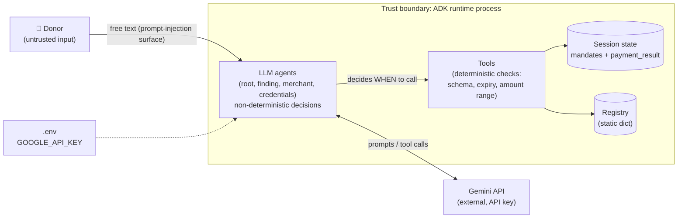

---
blueprint:
  type: nfr
  id: art_nfr-and-threats
  version: 1
  status: in_review
  inputs:
    artifacts:
      - { id: art_c4-container, version: 1 }
  evidence:
    - "afara-dada-code-agents/femtech_empowerment_funding_advisor/tools/payment_tools.py:128: consent_granted = True hard-coded"
    - "afara-dada-code-agents/femtech_empowerment_funding_advisor/credentials_provider/agent.py:76-78: FunctionTool without require_confirmation"
    - "afara-dada-code-agents/femtech_empowerment_funding_advisor/credentials_provider/agent_mock.py:7: import from non-existent package charity_advisor"
    - "afara-dada-code-agents/femtech_empowerment_funding_advisor/tools/merchant_tools.py:54-74,114: unkeyed truncated signature; amount read from dict with 0.0 default"
    - "afara-dada-code-agents/femtech_empowerment_funding_advisor/tools/femtechorgs_tools.py:23,53-76,88-90: docstring region west-africa; validation without registry lookup; name-derived ids"
    - "afara-dada-code-agents/femtech_empowerment_funding_advisor/agent.py:14-21: SequentialAgent containing a two-turn consent agent"
    - "requirements.txt:3: AP2 from git main, unpinned"
    - "README.md:28-43: Quick Start paths, my-demo placeholder branch, GOOGLE_API_KEY in .env, unused APIs enabled"
  guesses:
    - "Expected load is demo-scale (single donor sessions); no throughput or latency targets exist (see Q-10)"
    - "Whether the donor's 'yes' re-enters the pipeline at the merchant step (B-09) depends on ADK 1.17 runtime behaviour that is not visible in the repo (see Q-03)"
    - "Session state is in-memory and not durable unless a persistent ADK session service is configured at deploy time (see Q-10)"
---

# Non-functional characteristics and threats

The diagram shows the key point: **the LLM decides *when* a money-moving tool runs; the tools only decide *whether the inputs are well-formed*.** No deterministic control checks consent, registry membership or single use.

## Non-functional characteristics (as built)

| Quality | Current state | Evidence |
|---|---|---|
| **Correctness / determinism** | Business values (amount, recipient, ids, expiry) are computed in tools and passed through state, not through LLM arguments, from the cart step onward. Routing, region mapping and consent depend on the LLM. | `tools/merchant_tools.py:77`, `tools/payment_tools.py:95`, `agent.py:31-82` |
| **Security** | Tools are scoped per agent. Schema validation and expiry checks exist (intent 1 hour, cart 15 minutes). Signatures are simulated, consent is hard-coded, and there is no donor authentication in app code. | see STRIDE below |
| **Privacy** | No donor PII is collected (no name, email or card data). Logs contain organisation name and amount. | `tools/femtechorgs_tools.py:133`, `tools/payment_tools.py:149` |
| **Auditability** | The mandate chain and `payment_result` are kept in session state. Logs go to Python `logging` with no configured handler or sink. There is no durable ledger. | `tools/payment_tools.py:145-147` |
| **Availability / dependencies** | Every turn depends on Gemini `gemini-3-pro-preview`, a preview model that may change or be retired. There are no retries, fallback model or timeouts in app code. | all `agent.py` files |
| **Performance / cost** | One donor turn can trigger several LLM calls (root, then sub-agent, then tool round trips). The registry lookup is O(1) in memory. No latency budget is defined. | `agent.py:84-87` |
| **Scalability** | The process holds no state of its own; all state is in the session service. Scale therefore depends on the hosting runtime and session backend (not defined). | `scripts/test_merchant.py:26` (InMemorySessionService) |
| **Data freshness** | Organisation metrics are static literals ("Hosting major 2025 Summit"). Changing them needs a code release. | `data/femtech_programs.py:48` |
| **Maintainability** | The code is small and modular (one package per agent and a shared tools module). Prompts contain implementation details such as `_create_intent_mandate` and an example 2024 timestamp. Sub-package `__init__` files swallow ImportError. | `finding_agent/agent.py:43`, `credentials_provider/__init__.py:4-9` |
| **Testability** | There are no automated tests. `scripts/test_merchant.py` is a manual script that calls the live LLM. The auto-approve mock cannot be imported. | `scripts/test_merchant.py`, `credentials_provider/agent_mock.py:7` |
| **Reproducibility** | ADK and genai are pinned. AP2 tracks git `main`, and `google-cloud-aiplatform` is `>=1.111` with no upper bound. | `requirements.txt` |
| **Portability** | Tied to Google ADK and Gemini, and possibly to Vertex AI Agent Engine. | `requirements.txt:1-2,5` |
| **Internationalisation** | USD only. English prompts. | `tools/femtechorgs_tools.py:110` |

## STRIDE-lite threat list

| ID | STRIDE | Threat | Where | Current mitigation | Suggested direction |
|---|---|---|---|---|---|
| T-S1 | Spoofing | **Forged organisation signature.** `SIG_` is an unkeyed SHA-256 truncated to 16 hex characters. Anyone can compute it, and the payment step never checks it. | `tools/merchant_tools.py:54-74`, `tools/payment_tools.py:104-128` | None (simulation) | Real asymmetric signing per organisation, verified in `create_payment_mandate` (Q-06) |
| T-S2 | Spoofing | **Arbitrary recipient.** `save_user_choice` accepts any non-empty `org_name`. A donor message or injected text can steer the LLM to create an intent for an organisation that is not vetted. | `tools/femtechorgs_tools.py:53-76,116-145` | Prompt tells the agent to use the exact registry name | Check the name against the registry (by stable id) inside the tool (Q-04) |
| T-S3 | Spoofing | **No donor authentication** in app code. Identity is whatever `user_id` the host runtime supplies. | `scripts/test_merchant.py:30` | Delegated to host (assumed) | Define the authentication model at deployment (Q-07, Q-10) |
| T-T1 | Tampering | **State is shared and writable by every tool, with no integrity check between mandates.** The cart does not reference the intent id or hash, and the payment does not verify the cart signature. | `tools/*.py` | AP2 schema validation, expiry checks | Chain hashes or ids across mandates and verify them at each step |
| T-T2 | Tampering | **Amount taken from an extension field.** The cart amount is `intent_mandate_dict.get("amount", 0.0)`, which the AP2 model does not validate. A missing value gives a $0 cart. | `tools/merchant_tools.py:114` | None | Validate amount > 0 again in the merchant tool |
| T-R1 | Repudiation | **False consent record.** `consent_granted = True` is hard-coded, and the tool has no framework confirmation. If the LLM calls it without asking, the PaymentMandate still records `user_consent: true` with a timestamp. | `tools/payment_tools.py:128`, `credentials_provider/agent.py:76-78` | Prompt-level two-turn pattern only | `require_confirmation=True` and record the actual confirmation event (Q-03) |
| T-R2 | Repudiation | **No durable audit trail.** Mandates live in session state (in-memory by default), and logs have no configured sink. | `tools/payment_tools.py:145-147` | None | Persistent, append-only transaction ledger (Q-07) |
| T-I1 | Info disclosure | `GOOGLE_API_KEY` sits in a plaintext `.env`. The README enables Secret Manager, but the code does not use it. | `README.md:40-43`, `.gitignore:2` | `.env` is ignored by git | Load from Secret Manager in the cloud |
| T-I2 | Info disclosure | All raw registry records and donor messages are sent to an external LLM. Not sensitive today; card or KYC data would be in future. | `tools/femtechorgs_tools.py:49` | Agents told never to ask for card details | Keep payment credentials out of LLM context (AP2 credentials-provider model) |
| T-D1 | Denial of service | No rate limiting or quota protection in app code. Each turn makes several calls to a preview model, which exposes the project to cost blow-up and quota exhaustion. | all agents | None | Host-level quotas, cheaper model for routing |
| T-E1 | Elevation of privilege | **Prompt injection reaches the money path.** The LLM alone decides to transfer to the pipeline and to call `create_payment_mandate`. Tool scoping stops the finding agent from paying, but once in the pipeline nothing deterministic gates execution. | `agent.py:50-64`, `credentials_provider/agent.py` | Tool scoping per agent, expiry checks | Framework confirmation, deterministic phase guards |
| T-E2 | Elevation / Tampering | **Replay / double execution.** Intent and cart are never marked consumed. While they are unexpired, the pipeline or tool can run again and create new carts or transactions from the same intent. | `tools/merchant_tools.py:89-165`, `tools/payment_tools.py:104-147` | 1-hour / 15-minute expiry | Single-use mandates, idempotency key on transaction |
| T-SC1 | Supply chain | AP2 is installed from a git branch head (`@main`). An upstream change or compromise flows straight into payment code. | `requirements.txt:3` | None | Pin to a commit or tag (Q-09) |

## Bugs and risks noticed in the code

These are recorded only; no code was changed.

| ID | Severity | Finding | Location |
|---|---|---|---|
| B-01 | High (tests) | `agent_mock.py` imports `charity_advisor.tools.payment_tools`. That package does not exist (it should be `femtech_empowerment_funding_advisor`), so importing the module raises ImportError. | `credentials_provider/agent_mock.py:7` |
| B-02 | High | `consent_granted = True` is hard-coded, so `user_consent` is always true no matter what the donor said. | `tools/payment_tools.py:128` |
| B-03 | High | The production `create_payment_mandate` tool is registered without `require_confirmation=True`. The mock's comment "← Only difference" (`require_confirmation=False`) implies the real agent was meant to set it to True. | `credentials_provider/agent.py:76-78` vs `agent_mock.py:15` |
| B-04 | Medium | The donation choice is not checked against the vetted registry. The prompt claims "The system uses the Organization Name for validation", but the tool only checks that the name is not empty. | `tools/femtechorgs_tools.py:53-76`, `finding_agent/agent.py:37` |
| B-05 | Medium | Region mismatch. The tool docstring offers `west-africa`, which is not in the data. The finding prompt uses "East Africa", "Global Diaspora" and "Pan-Africa" with spaces and capitals, but lookup is exact on hyphenated lowercase keys. Unless the LLM normalises the input, the result is `not_found`. | `tools/femtechorgs_tools.py:23`, `finding_agent/agent.py:21`, `data/femtech_programs.py:76` |
| B-06 | Low | `NaN` passes amount validation, because `NaN <= 0` and `NaN > 1e6` are both False. Money is held as `float` everywhere, which risks rounding errors. | `tools/femtechorgs_tools.py:69-74` |
| B-07 | Medium | The merchant signature is unkeyed, truncated to 64 bits and never verified downstream (see T-S1). | `tools/merchant_tools.py:54-74` |
| B-08 | Medium | Mandates are not idempotent or single-use. Re-running the pipeline creates new carts and transactions from the same intent (see T-E2). | `tools/merchant_tools.py`, `tools/payment_tools.py` |
| B-09 | Medium (unverified) | Two-turn consent inside a `SequentialAgent`. After the CredentialsProvider asks "Proceed?", the turn ends. On the donor's "yes", ADK may send control back to the root, which may re-delegate to the whole pipeline. That would run the merchant step again (a new cart) before payment, or never return to the CredentialsProvider. Behaviour depends on the ADK 1.17 runtime and must be tested. | `agent.py:14-21`, `credentials_provider/agent.py:33-39` |
| B-10 | Low | `cart_mandate` amount defaults to `0.0` if the intent's `amount` extension field is missing (see T-T2). | `tools/merchant_tools.py:114` |
| B-11 | Low | Inconsistent flags. The intent sets `user_cart_confirmation_required=True`, but the cart sets `user_cart_confirmation_required=False`. | `tools/femtechorgs_tools.py:93`, `tools/merchant_tools.py:148` |
| B-12 | Low | `intent_id = fund_<name[:10]>_<epoch seconds>` can collide for the same organisation within one second. The name-derived "registration id" truncates names (e.g. both "Women in Tech Africa" and a hypothetical "Women in Tech Asia" give `WOMENINTEC`). | `tools/femtechorgs_tools.py:88-90,107` |
| B-13 | Low | The sub-package `__init__.py` files catch `ImportError`/`AttributeError` and silently export nothing. This hides real import failures (such as B-01 if the mock were wired in). | `finding_agent/__init__.py`, `merchant_agent/__init__.py`, `credentials_provider/__init__.py` |
| B-14 | Low | The finding prompt leaks implementation detail ("the function to create this is `_create_intent_mandate`…") and a stale example date (2024-11-07). | `finding_agent/agent.py:43` |
| B-15 | Low (docs) | README Quick Start problems: it says `cd afara-dada-code-agents` straight after cloning `Afara-Dada-Code` (missing the repo directory), checks out a placeholder `my-demo` branch, shows `.env` content wrapped in backticks with spaces around `=`, and enables Secret Manager and Cloud Trace APIs that the code does not use. | `README.md:28-43` |
| B-16 | Low | Dependency drift: AP2 `@main` is unpinned and `google-cloud-aiplatform>=1.111` has no upper bound. | `requirements.txt:2-3` |
| B-17 | Low | There is no automated test suite. The only script calls the live LLM, so CI cannot run it without credentials. | `scripts/test_merchant.py` |
