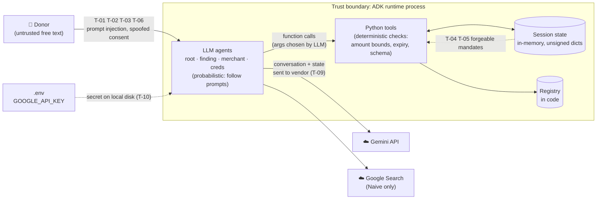

---
blueprint:
  type: nfr
  id: art_nfr-and-threats
  version: 1
  status: in_review
  inputs:
    artifacts:
      - { id: art_c4-container, version: 1 }
  evidence:
    - "afara-dada-code-agents/femtech_empowerment_funding_advisor/tools/femtechorgs_tools.py:53-154: validation (amount bounds only), org name never checked against registry, intent_id from name + epoch seconds"
    - "afara-dada-code-agents/femtech_empowerment_funding_advisor/tools/merchant_tools.py:54-74,113-114: unkeyed hash signature, amount default 0.0, 'Unknown Initiative' fallback"
    - "afara-dada-code-agents/femtech_empowerment_funding_advisor/tools/payment_tools.py:95-147: consent hard-coded True, no signature verification, simulated token"
    - "afara-dada-code-agents/femtech_empowerment_funding_advisor/credentials_provider/agent.py:76-78 and agent_mock.py:7,15: no require_confirmation; mock imports charity_advisor"
    - "afara-dada-code-agents/femtech_empowerment_funding_advisor/agent.py:14-21,46-48: SequentialAgent pipeline, text-cue phase detection"
    - "requirements.txt: AP2 @main, google-cloud-aiplatform unpinned lower bound; README.md:28-36 setup steps"
    - "afara-dada-code-agents/scripts/test_merchant.py: only test, live-LLM manual script, InMemorySessionService"
  guesses:
    - "Runtime is a single process with in-memory sessions; no scaling, persistence or HA configuration exists (see Q-05)"
    - "On the consent turn ADK routes to the root agent, which can re-run the whole pipeline (T-07); not verified by running the app (see Q-02)"
    - "AP2 Pydantic models accept extra keys; if they forbid extras, create_cart_mandate always fails (see Q-07)"
    - "No production traffic or SLOs exist; NFR targets below describe current behaviour, not agreed goals (see Q-05)"
---

# Non-functional characteristics and threats

## Non-functional characteristics (as built)

| Quality | Current behaviour | Evidence | Gap or risk |
|---------|-------------------|----------|-------------|
| **Correctness of money amount** | The amount is validated once (0 < amount ≤ USD 1,000,000) and then passed through state, not retyped by the LLM. | `femtechorgs_tools.py:68-75`, `merchant_tools.py:114` | The merchant falls back to `0.0` when `amount` is missing. No currency other than USD is accepted. |
| **Time-boxed validity** | Intent lasts 1 h and cart 15 min, both checked in Python with UTC timestamps. | `merchant_tools.py:26-51`, `payment_tools.py:18-45` | Comparisons use `<` with no clock-skew allowance (acceptable in a single process). |
| **Auditability** | The three mandates and the payment result are kept in session state. Every tool call is logged. | `tools/*.py` | State is in memory and each key is overwritten, so nothing persists and there is no history. Logs are not structured. Cloud Trace is enabled in the README but not wired up. |
| **Determinism and reliability** | Tools fail closed with `{status:"error"}`. | `tools/*.py` | Phase changes, consent and region mapping depend on LLM behaviour. The root agent detects completion from text cues (`agent.py:46-48`). |
| **Performance and cost** | Every turn is one or more Gemini calls to a large *preview* model. The pipeline runs two LLM agents back to back. | `*/agent.py` | No caching, timeouts or retry policy. `find_tech_initiatives` returns formatted and raw data together, doubling tokens. |
| **Scalability and availability** | One process, in-memory sessions, a static registry. | `scripts/test_merchant.py:26`, `data/femtech_programs.py` | Not horizontally scalable as built, and a restart loses state (guess: Q-05). |
| **Maintainability** | The package is clean and each agent sits in its own folder. Docstrings are thorough. | repo layout | The model name is hard-coded 5 times. Some comments are stale ("Updated import to match your new…"). The finding prompt tells the LLM about the private `_create_intent_mandate` and gives a 2024 example date. |
| **Testability** | One manual script runs merchant_agent alone against live Gemini. | `scripts/test_merchant.py` | No unit tests for the pure tool functions, which are easy to test. The mock agent cannot be imported. There is no CI. |
| **Reproducible builds** | Versions are pinned for ADK, genai and dotenv. | `requirements.txt` | AP2 comes from `@main`. `google-cloud-aiplatform>=1.111` has only a lower bound. The README says to `pip install -r requirements.txt` *after* `cd afara-dada-code-agents`, but the file is in the repo root. The README also checks out a `my-demo` branch. |
| **Privacy** | No PII is collected: the donor is only a session user_id and no card data is requested. | `finding_agent/agent.py:50` | The whole conversation and state go to the Gemini API, which is a vendor data-processing concern. |
| **Accessibility and i18n** | English only. Output uses emoji-rich markdown. | `femtechorgs_tools.py:173-180` | No localisation for donors in other languages. |

## STRIDE-lite threat list

| ID | STRIDE | Threat | Where | Likelihood / Impact | Mitigation (proposed) |
|----|--------|--------|-------|---------------------|-----------------------|
| T-01 | **S**poofing / **T**ampering | **Funding an unvetted organisation.** `save_user_choice` accepts any non-empty `org_name`. A donor, or a prompt-injected LLM, can create an intent for "Totally Real NGO", which defeats the whole trust layer. | `femtechorgs_tools.py:53-76,116-145` | High / High | Check `org_name` against the registry (by ID, not by free text) inside the tool (Q-03). |
| T-02 | **R**epudiation / **E**levation | **Payment without consent.** Consent depends only on the prompt. `create_payment_mandate` has no confirmation gate and always records `user_consent: true`, so the record can claim consent that was never given. | `credentials_provider/agent.py:33-39,76-78`, `payment_tools.py:128` | Medium / High | Use `FunctionTool(require_confirmation=True)` or a consent token that must come from the user turn, and record the real answer (Q-02). |
| T-03 | **T**ampering (prompt injection) | Donor text can tell the LLM agents to skip steps, call tools in a different order, or claim "IntentMandate created", which the root agent relies on to switch phase. | `agent.py:46-48`, all instructions | Medium / Medium | Detect phases from state (`intent_mandate` present and valid), not from text, and make tools enforce their preconditions. |
| T-04 | **S**poofing / **T**ampering | **Forgeable merchant signature.** `SIG_` plus a truncated, unkeyed SHA-256 hash can be recomputed by anyone, and the Credentials Provider never checks it. | `merchant_tools.py:54-74`, `payment_tools.py:95-131` | Low now (simulated) / High if real | Use real asymmetric signatures held by each organisation, and verify them before paying (Q-07). |
| T-05 | **T**ampering | **Broken chain linkage.** The cart does not record `intent_id`, and the payment step does not check that the cart matches the current intent. A replaced or stale `cart_mandate` in state is accepted if it has not expired. | `merchant_tools.py:144-165`, `payment_tools.py:104-131` | Low / Medium | Embed the intent ID and a hash in the cart, and the cart hash in the payment, then verify both. |
| T-06 | **D**enial of service / cost | An unbounded conversation on a large preview model, with no rate limits, quotas or auth, can drive up Gemini cost. | `*/agent.py` (no limits) | Medium / Medium | Add auth, per-user quotas and token budgets at the hosting layer (Q-05). |
| T-07 | **T**ampering (integrity of flow) | **Pipeline re-entry on the consent turn (guess).** The "yes" most likely reaches the root agent, which runs the SequentialAgent again. `merchant_agent` then builds a new cart that overwrites the old one, and the donor confirms one cart ID but pays another. A double payment is possible if the LLM loops. | `agent.py:14-21`, `credentials_provider/agent.py:33-39` | Medium / Medium | Move consent outside the SequentialAgent, or use tool confirmation so the pause happens inside the tool. Add idempotency on `intent_id`. Verify at runtime. |
| T-08 | **I**nformation disclosure | The Naive_Agent returns unverified web content, possibly including impersonating or fraudulent "charities", with no warning in code. | `Naive_Agent/agent.py` | Low (demo) / Medium | Keep it demo-only or label its results as unverified (Q-10). |
| T-09 | **I**nformation disclosure | The full conversation and state, including donor intent and amounts, are sent to the Gemini API. Logs record org names and amounts. | `*/agent.py`, `tools/*.py` logging | Low / Low | Document data processing and choose the Vertex AI region and retention settings. |
| T-10 | **I**nformation disclosure | `GOOGLE_API_KEY` sits in a plain `.env` file. It is git-ignored, which is good. The README enables Secret Manager, but no code uses it. | `.gitignore:2`, `README.md:40-43` | Low / Medium | Load the key from Secret Manager when deployed. |
| T-11 | **T**ampering (supply chain) | The AP2 dependency follows the `@main` branch of a GitHub repo, so a malicious or breaking upstream commit installs without review. | `requirements.txt:3` | Low / High | Pin to a commit SHA or release tag and verify hashes. |

## Bugs and code risks noticed (not fixed: docs-only mandate)

| ID | Finding | Location |
|----|---------|----------|
| B-01 | `agent_mock.py` imports `charity_advisor.tools.payment_tools`, a package that does not exist, so importing it raises `ImportError`. The "← Only difference" comment is also wrong: the instruction differs too, and `require_confirmation=False` is already the default. | `credentials_provider/agent_mock.py:7,15` |
| B-02 | `consent_granted = True` is hard-coded, so `user_consent` is always true, whatever the donor said. | `tools/payment_tools.py:128` |
| B-03 | Organisation names are never checked against the registry (see T-01). The prompt claims "The system uses the Organization Name for validation", which is untrue. | `tools/femtechorgs_tools.py:53-76`, `finding_agent/agent.py:37` |
| B-04 | The region lookup only matches exact keys. The docstring advertises `'west-africa'`, which does not exist. The prompt's examples ("East Africa", "Global Diaspora") will not match unless the LLM turns them into slugs. | `tools/femtechorgs_tools.py:23`, `data/femtech_programs.py:76`, `finding_agent/agent.py:21` |
| B-05 | `intent_id` is built from name and epoch **seconds**, so two intents for the same organisation in the same second collide. The mock registration ID (`[:10]` of the name) can also collide between organisations. | `tools/femtechorgs_tools.py:90,107` |
| B-06 | `create_cart_mandate` falls back to `amount` `0.0` and to `"Unknown Initiative"` instead of failing, which could produce a zero-value or unnamed cart. | `tools/merchant_tools.py:113-114` |
| B-07 | The IntentMandate sets `user_cart_confirmation_required=True`, but the CartMandate sets it to `False`, so the intent's requirement is silently dropped. | `tools/femtechorgs_tools.py:93`, `tools/merchant_tools.py:148` |
| B-08 | The root agent detects Phase 1 completion from text patterns, not from state. | `agent.py:46-48` |
| B-09 | The README setup has wrong paths: `cd afara-dada-code-agents` and then `pip install -r requirements.txt`, but the file is at the repo root. It also checks out a `my-demo` branch, and `.env` uses the `GOOGLE_API_KEY =""` form with a space. | `README.md:28-43` |
| B-10 | The finding prompt tells the LLM about the internal `_create_intent_mandate` function and an example expiry in 2024. That is noise, and an LLM might mention it to donors. | `finding_agent/agent.py:43` |
| B-11 | The top-level package `__init__.py` is empty and does not import `agent`, unlike `Naive_Agent/__init__.py`. Whether the ADK loader finds `root_agent` depends on how the app is launched (guess: Q-05). | `femtech_empowerment_funding_advisor/__init__.py` |
| B-12 | The amount is formatted with `$` in user messages, while the Credentials Provider prompt hard-codes "$X". This is fine for USD only, but wrong if other currencies are added (Q-06). | `credentials_provider/agent.py:36` |
