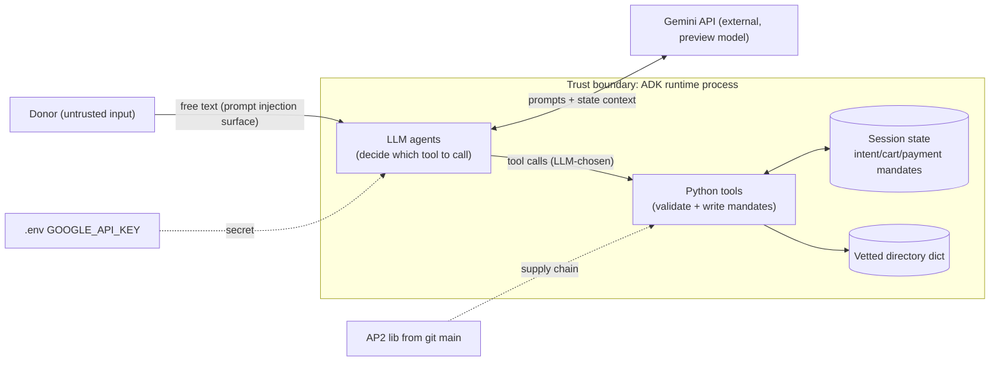

---
blueprint:
  type: nfr
  id: art_nfr-and-threats
  version: 1
  status: in_review
  inputs:
    artifacts:
      - { id: art_c4-container, version: 1 }
  evidence:
    - "afara-dada-code-agents/femtech_empowerment_funding_advisor/tools/payment_tools.py:128: consent_granted = True hard-coded"
    - "afara-dada-code-agents/femtech_empowerment_funding_advisor/credentials_provider/agent.py:76-78: FunctionTool(func=create_payment_mandate) without require_confirmation"
    - "afara-dada-code-agents/femtech_empowerment_funding_advisor/tools/merchant_tools.py:54-74,114,148: unkeyed truncated hash signature; amount default 0.0; cart user_cart_confirmation_required=False"
    - "afara-dada-code-agents/femtech_empowerment_funding_advisor/tools/femtechorgs_tools.py:53-76,90,107: no directory check on org_name; intent_id from name + epoch seconds"
    - "afara-dada-code-agents/femtech_empowerment_funding_advisor/credentials_provider/agent_mock.py:7: import from non-existent charity_advisor package"
    - "afara-dada-code-agents/scripts/test_merchant.py:19: imports root_agent from merchant_agent.agent, which only defines merchant_agent"
    - "requirements.txt:3: AP2 from git main (unpinned)"
    - "README.md:28-36: Quick Start cd and requirements path; .gitignore:2 ignores .env"
    - "All agents: model='gemini-3-pro-preview' (preview model)"
  guesses:
    - "Expected load is demo-scale: a handful of concurrent donors, no SLA (see Q-05)"
    - "No real money moves today, so the financial threats below are rated for a future real-payment version (see Q-02)"
    - "Sessions live in memory in the ADK runtime and are lost on restart (see Q-05)"
---

# Afara Dada Code – Non-functional characteristics and threats

The key point: **a probabilistic component (the LLM) decides whether and when the money-moving tool runs.** The
deterministic tools validate structure and expiry, but they do not check consent or that the organisation is in
the vetted directory.

## Non-functional characteristics (as built)

| Quality | Current state | Evidence |
|---------|---------------|----------|
| Performance / latency | Each donor turn makes at least one Gemini call, and the full flow makes roughly 6–10. The tools themselves are in-memory and take microseconds. Latency depends on the preview Gemini model. | all `agent.py` |
| Scalability | Stateless code with in-memory session state. Scaling out needs a shared session service, and none is configured. | `scripts/test_merchant.py:26` |
| Availability | Depends on Gemini preview availability and on the hosting runtime. No retries or fallback model. | `model="gemini-3-pro-preview"` |
| Durability / audit | Mandates exist only in session state and are lost on restart. There is no audit log beyond Python `logging`, which has no configured sink. | `tools/*.py` |
| Correctness of money | Amounts are `float` in USD only. There is no decimal type and no currency conversion. | `tools/femtechorgs_tools.py:110`, `tools/merchant_tools.py:134` |
| Security | Structure and expiry checks in the tools. Consent and the organisation allow-list rely on the prompt alone. The signature is simulated. | ADR 0004 |
| Privacy | No PII is collected (no names, emails or card numbers). The conversation goes to Gemini. | `finding_agent/agent.py:50` |
| Observability | `logging.info/error` in the tools. Cloud Trace is enabled in the README but not wired up. | `README.md:40` |
| Testability | No automated tests. The only script and the mock agent both fail to import (see below). | `scripts/test_merchant.py:19`, `agent_mock.py:7` |
| Maintainability | Small, clearly layered code (agents, tools, data). Prompts are long and duplicate the protocol description. Template leftovers remain (`charity_advisor`). | — |
| Portability | Python 3.9+ (PEP 585 hints). Tied to Google ADK, Gemini and Google Cloud. | ADR 0001 |

## STRIDE-lite threat list

| # | STRIDE | Threat | Where | Likelihood / impact | Mitigation idea |
|---|--------|--------|-------|---------------------|-----------------|
| T-01 | **Spoofing / Elevation** | Prompt injection, or the model ignoring its prompt, makes the CredentialsProvider call `create_payment_mandate` without a real "yes". The record still says `user_consent: true`. | `payment_tools.py:128`, `credentials_provider/agent.py:76-78` | High / High once money is real | Use `require_confirmation=True` (ADK tool confirmation). Record consent from the actual user event, not a constant. (Q-03) |
| T-02 | **Tampering** | An IntentMandate is created for an organisation **not** in the vetted directory, such as a name an attacker types. Merchant and payment steps accept it. | `femtechorgs_tools.py:53-76`, `merchant_tools.py:113` | Medium / High | Check `org_name` against `get_initiatives_by_region("africa")` in `save_user_choice` and again in `create_cart_mandate`. (Q-01) |
| T-03 | **Spoofing / Tampering** | The CartMandate "signature" is an unkeyed hash truncated to 64 bits. Anyone who can edit state can change the cart and recompute it, and the payment tool never verifies it anyway. | `merchant_tools.py:54-74`, `payment_tools.py:104-121` | Low today / High in production | Use real keyed signatures (HMAC or asymmetric keys) and verify them in `create_payment_mandate`. (Q-04) |
| T-04 | **Repudiation** | Nothing is persisted or logged in a tamper-evident way about who consented to what. Declines and cancellations are not recorded. | `tools/*.py` | Medium / Medium | Use a persistent append-only audit log of mandates and consent events. (Q-05) |
| T-05 | **Tampering / Repudiation** | Double execution: `create_payment_mandate` can be called again while the cart is still valid, giving two transactions for one cart. State is not cleared after a payment. | `payment_tools.py:95-157` | Medium / High | Add an idempotency key per cart and mark the cart as consumed. |
| T-06 | **Information disclosure** | `GOOGLE_API_KEY` sits in plain `.env`. It is git-ignored, but there is no Secret Manager integration even though the README enables that API. | `.gitignore:2`, `README.md:40-44` | Low / Medium | Load the key from Secret Manager or use workload identity on Vertex AI. |
| T-07 | **Information disclosure** | All donor conversation text and `raw_data` go to an external LLM. Logs contain organisation names and amounts. | `femtechorgs_tools.py:49,133` | Low / Low | Write a data-handling notice and decide log retention. |
| T-08 | **Denial of service** | Unbounded chat turns, each one a paid Gemini call. There are no rate limits or quotas in the code. | runtime | Medium / Medium (cost) | Add runtime-level quotas and per-session turn caps. |
| T-09 | **Tampering (supply chain)** | AP2 is installed from `git+...@main`, unpinned. A compromised or changed upstream runs in the payment path. | `requirements.txt:3` | Medium / High | Pin to a commit SHA or a release, and add hash-checking. |
| T-10 | **Spoofing (misleading output)** | The donor is told funds were "transferred successfully" while `simulation: true`. Only the prompt asks for the "(simulated)" disclaimer. | `payment_tools.py:154`, `credentials_provider/agent.py:50` | Medium / Medium (reputation) | Put the simulation flag into the tool's returned message. |

## Bugs and defects noticed (not fixed – documentation only)

1. **The test script import is broken.** `scripts/test_merchant.py:19` imports `root_agent` from
   `femtech_empowerment_funding_advisor.merchant_agent.agent`, but that module only defines `merchant_agent`.
   `root_agent` is defined in `merchant_agent/__init__.py`. The import raises `ImportError`.
2. **The mock agent import is broken.** `credentials_provider/agent_mock.py:7` imports
   `charity_advisor.tools.payment_tools`, a package that does not exist here. It is a template leftover.
3. **Consent is hard-coded.** `payment_tools.py:128` sets `consent_granted = True` whatever the donor said. The
   real agent's `FunctionTool` lacks `require_confirmation=True`, although `agent_mock.py:15` implies that
   setting is the only difference.
4. **The organisation allow-list is not enforced** after discovery (T-02).
5. **A missing amount silently becomes 0.** `merchant_tools.py:114` uses `intent_mandate_dict.get("amount", 0.0)`.
   The cart path never re-checks amount > 0.
6. **Confirmation flags disagree.** The intent sets `user_cart_confirmation_required=True`
   (`femtechorgs_tools.py:93`), but the cart sets it to `False` (`merchant_tools.py:148`) and nothing acts on
   either value.
7. **Prompt and code disagree on payment methods.** The merchant prompt promises "card, bank transfer"
   (`merchant_agent/agent.py:54`), but only `CARD` is built (`merchant_tools.py:124`).
8. **Region vocabulary mismatches.** The tool docstring mentions `west-africa`, which has no data. Prompts use
   "East Africa" and "Global Diaspora", which never match keys after `.lower()` unless the LLM rewrites them.
9. **The intent ID can collide.** `fund_<name10>_<epoch seconds>` repeats for two intents created for the same
   organisation in the same second (`femtechorgs_tools.py:107`).
10. **The finding agent prompt leaks implementation detail.** `finding_agent/agent.py:43` tells the model about
    `_create_intent_mandate` in `femtechorgs_tools.py`, which may surface to donors.
11. **The README Quick Start path is wrong.** It clones `Afara-Dada-Code` and then `cd afara-dada-code-agents`,
    a sub-directory, but `requirements.txt` is at the repo root while `setup.py` is in the sub-directory. It also
    checks out a `my-demo` branch that may not exist (`README.md:28-36`).
12. **Phase 2 is triggered by text.** The root agent moves on when it sees "IntentMandate created" in text
    (`agent.py:46-48`), not by checking `state["intent_mandate"]`.
13. **A preview model is used in every agent** (`gemini-3-pro-preview`). It may be renamed or withdrawn.
