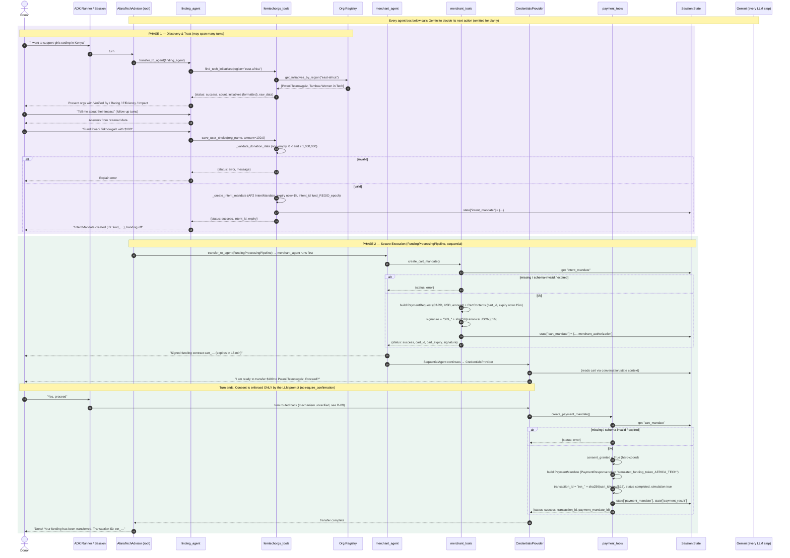

---
blueprint:
  type: sequence
  id: art_seq-donor-funding-flow
  version: 1
  status: in_review
  inputs:
    artifacts:
      - { id: art_c4-container, version: 1 }
  evidence:
    - "afara-dada-code-agents/femtech_empowerment_funding_advisor/agent.py:31-82: two-phase workflow and example flow in root instruction"
    - "afara-dada-code-agents/femtech_empowerment_funding_advisor/tools/femtechorgs_tools.py:18-154: find_tech_initiatives, _validate_donation_data, _create_intent_mandate, save_user_choice"
    - "afara-dada-code-agents/femtech_empowerment_funding_advisor/tools/merchant_tools.py:77-175: create_cart_mandate steps 1-8"
    - "afara-dada-code-agents/femtech_empowerment_funding_advisor/tools/payment_tools.py:95-157: create_payment_mandate steps 1-7"
    - "afara-dada-code-agents/femtech_empowerment_funding_advisor/credentials_provider/agent.py:33-39: two-turn confirmation"
  guesses:
    - "After the donor answers 'yes', ADK sends that turn back into the CredentialsProvider. Whether it does so directly or through the root re-entering the pipeline (which would re-run the merchant step) is not determined by the code (see Q-03)"
    - "The LLM turns the donor's phrasing (e.g. 'Kenya', 'East Africa') into a registry key such as 'east-africa' (see Q-05)"
---

# Sequence: donor discovers an initiative and funds it (main flow)

## Notes

- **Why this flow.** It is the system's only business flow, and the root instruction (`agent.py:66-76`) states it as the canonical example. Every other component, including the Naive agent and the test script, exists to support or demo it.
- **Where checks happen.** Deterministic checks live only in the tools: donation validation, schema validation through the AP2 models, and expiry checks. Routing, choosing the region key, deciding the user has "selected" an org, and consent are all made by the LLM.
- **Where data comes from.** The amount reaches the cart from the intent dict's extension field `amount` (`merchant_tools.py:114`), not from a validated model field. If it is missing, it silently defaults to `0.0`.
- **What can fail.** Any step can return `{status: error}`. No step retries or rolls back, and the earlier mandates stay in state. Expired intents or carts cause errors, but the code has no path to re-issue them other than the LLM calling the tool again.
- **Consent turn (steps after "Proceed?").** ADK's SequentialAgent does not natively pause for user input. How the donor's "yes" reaches the CredentialsProvider (directly, or by the root re-delegating to the pipeline, which would make a new cart first) is not shown in the code. See NFR B-09 and Q-03.
