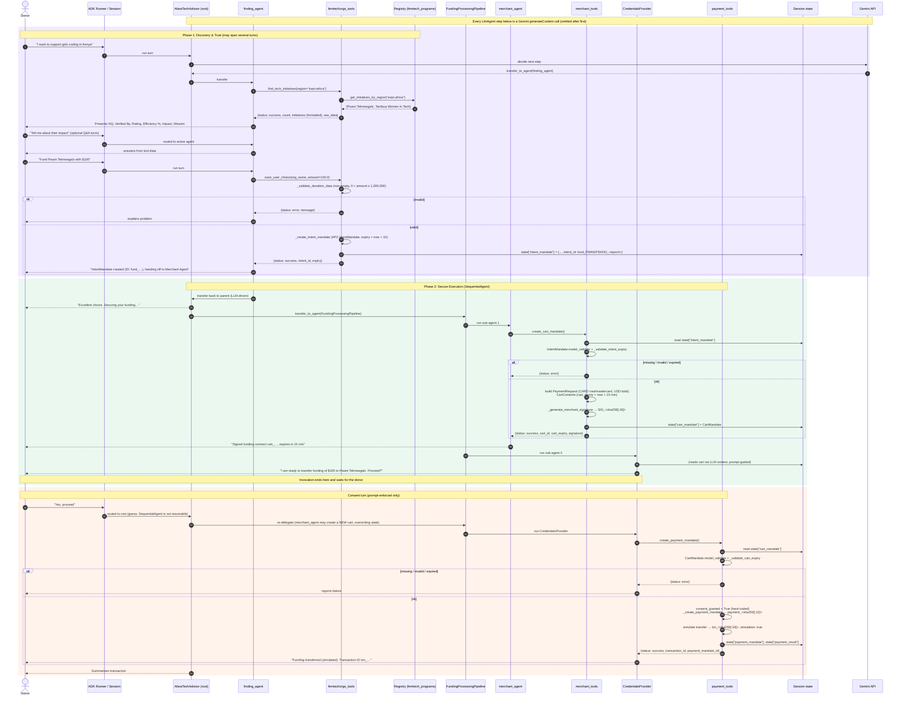

---
blueprint:
  type: sequence
  id: art_seq-fund-initiative
  version: 1
  status: in_review
  inputs:
    artifacts:
      - { id: art_c4-container, version: 1 }
  evidence:
    - "afara-dada-code-agents/femtech_empowerment_funding_advisor/agent.py:31-82: two-phase instruction and example flow"
    - "afara-dada-code-agents/femtech_empowerment_funding_advisor/tools/femtechorgs_tools.py:18-154: find_tech_initiatives, _validate_donation_data, _create_intent_mandate, save_user_choice"
    - "afara-dada-code-agents/femtech_empowerment_funding_advisor/tools/merchant_tools.py:77-175: create_cart_mandate steps 1-8"
    - "afara-dada-code-agents/femtech_empowerment_funding_advisor/tools/payment_tools.py:95-157: create_payment_mandate steps 1-7"
    - "afara-dada-code-agents/femtech_empowerment_funding_advisor/credentials_provider/agent.py:33-39: two-turn confirmation pattern"
  guesses:
    - "The donor's 'yes' after the consent question arrives as a new invocation routed to the root agent, which re-delegates to the pipeline, so merchant_agent may run again and create a second cart (see Q-02)"
    - "The LLM maps free-text regions like 'Kenya' to the key 'east-africa' before calling the tool; nothing in code does this mapping (see Q-08)"
---

# Sequence: Donor funds a verified initiative (end to end)

## Notes

- **Why this flow.** It is the system's reason to exist, and it touches every agent, every tool and all four state keys.
- **Handoffs go only through state.** No tool gets the previous mandate as an argument. Each one reads it from `tool_context.state`, so a missing key is caught and returned as `{status: error}`.
- **Expiry windows.** The intent lasts 1 hour and the cart 15 minutes. Both are checked in tool code (`merchant_tools.py:26-51`, `payment_tools.py:18-45`), so they do not depend on the LLM.
- **Consent is not enforced in code.** The consent turn depends on the Credentials Provider LLM obeying its instruction. The tool has no `require_confirmation` and always records `user_consent: true`.
- **Phase change is detected from text.** The root agent decides Phase 1 is complete by looking for "IntentMandate created" or "Intent ID: fund_xxx" in the conversation (`agent.py:46-48`). It does not check `state["intent_mandate"]`.
- **Re-entry after consent is a guess.** In ADK, a `SequentialAgent` cannot be resumed partway through a turn. The donor's "yes" therefore most likely reaches the root agent, and running the pipeline again runs `merchant_agent` first. That would regenerate and overwrite `cart_mandate` before payment. Behaviour depends on the LLM, so it must be verified at runtime (see NFR document, T-07).
