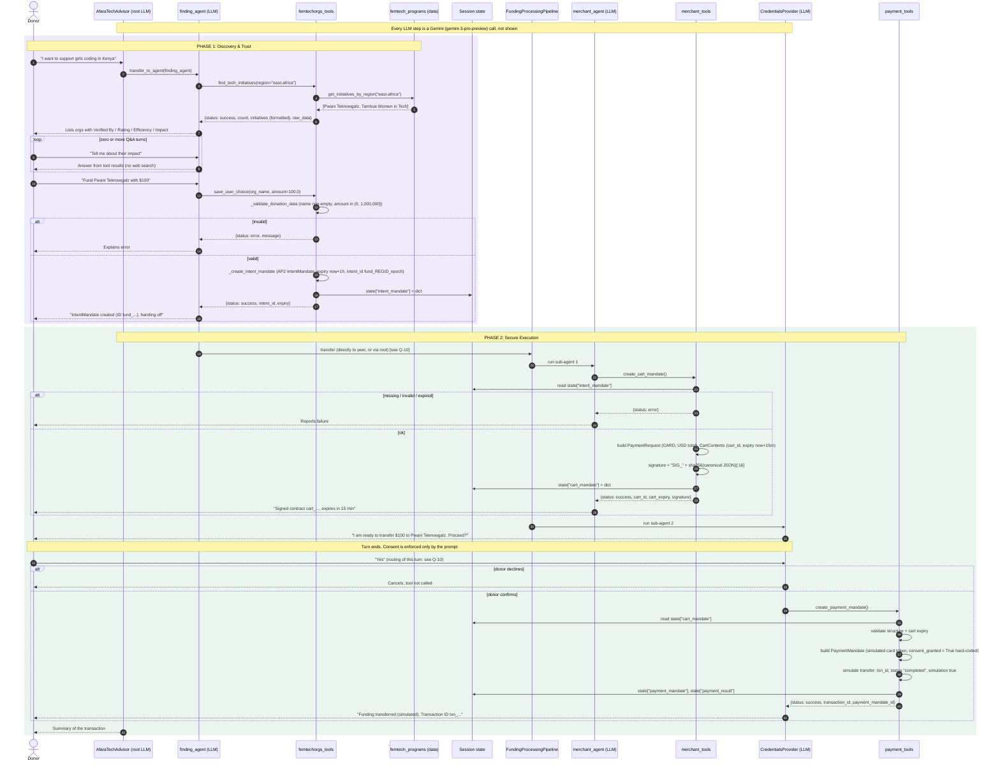

---
blueprint:
  type: sequence
  id: art_seq-fund-initiative
  version: 1
  status: in_review
  inputs:
    artifacts:
      - { id: art_c4-container, version: 1 }
  evidence:
    - "afara-dada-code-agents/femtech_empowerment_funding_advisor/agent.py:31-76: two-phase instruction and example flow (discover, ask, select, IntentMandate, pipeline, consent, payment, summary)"
    - "afara-dada-code-agents/femtech_empowerment_funding_advisor/tools/femtechorgs_tools.py:18-50,116-154: find_tech_initiatives and save_user_choice"
    - "afara-dada-code-agents/femtech_empowerment_funding_advisor/tools/merchant_tools.py:77-175: create_cart_mandate steps 1-8"
    - "afara-dada-code-agents/femtech_empowerment_funding_advisor/tools/payment_tools.py:95-157: create_payment_mandate steps 1-7"
    - "afara-dada-code-agents/femtech_empowerment_funding_advisor/credentials_provider/agent.py:33-39: two-turn confirmation pattern"
  guesses:
    - "After the finding agent saves the intent, control reaches the pipeline either by the finding agent transferring to its peer or by a transfer back to the root agent. The prompts allow both, and the code does not fix one path (see Q-10)"
    - "The donor's 'yes' on the confirmation turn reaches the CredentialsProvider. With ADK 1.17 routing it may instead return to the root agent and re-run the whole pipeline, which would create a new cart before consent is asked again (see Q-10)"
    - "Every agent turn involves at least one Gemini call. Those calls are omitted from the diagram for readability"
---

# Sequence: Donor funds a vetted initiative (discover → intent → cart → consent → payment)

## Notes

1. **Why this flow.** It is the product's only end-to-end business flow. Every other part of the repo (the Naive agent,
   the test script, the mock) supports or contrasts with it.
2. **Gates are mostly probabilistic.** Three conditions are checked by code: amount/name validity (step "validate"),
   intent expiry and cart expiry. Three are only asked for in prompts: "only proceed to Phase 2 after a valid
   IntentMandate", "only call the payment tool after explicit confirmation", and "do not search the open web".
   An LLM slip or a prompt injection can skip any of the prompt-only gates.
3. **Region mapping is done by the LLM.** "Kenya" works only if Gemini picks `east-africa`. The tool does exact key
   matching (`femtech_programs.py:70-76`).
4. **State hand-off.** Each tool re-validates the previous mandate with its AP2 Pydantic model. The cart amount,
   however, comes from the *extension* field `intent_mandate["amount"]` (`merchant_tools.py:114`), not from a signed or
   validated field.
5. **Timing budget.** Once the cart exists the donor has 15 minutes to confirm, or the payment tool returns
   "expired". The intent allows 1 hour between choice and cart creation.
6. **Possible re-run on confirmation (to verify).** `credentials_provider` sits under a SequentialAgent. If ADK sends
   the next user message back to the root agent, which is likely because a SequentialAgent is not an LLM agent that
   can take a transfer, the root may start the pipeline again. The merchant would then overwrite `cart_mandate` and
   the consent question would repeat. This flow should be tested end to end (Q-10).
