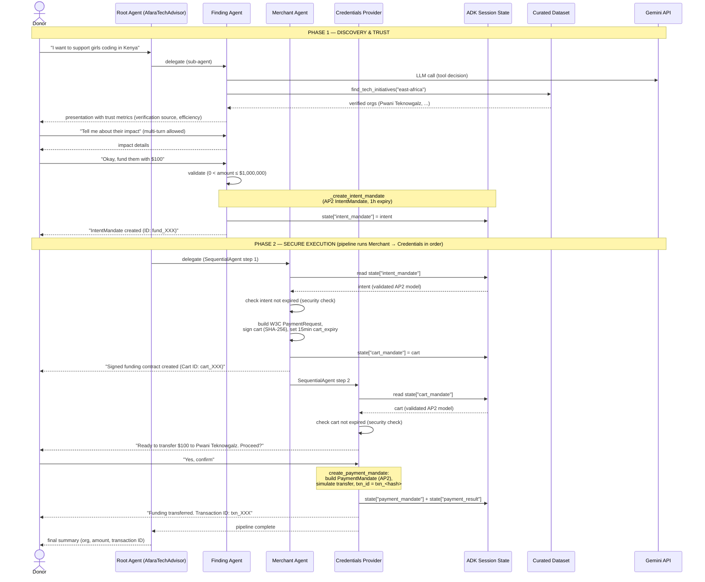

---
blueprint:
  type: sequence
  id: art_seq-funding-flow
  version: 1
  status: in_review
  inputs:
    artifacts:
      - { id: art_c4-container, version: 1 }
  evidence:
    - "afara-dada-code-agents/femtech_empowerment_funding_advisor/agent.py:26-88 — example flow embedded in the root agent instruction"
    - "afara-dada-code-agents/femtech_empowerment_funding_advisor/tools/femtechorgs_tools.py:79-154 — IntentMandate creation and state write"
    - "afara-dada-code-agents/femtech_empowerment_funding_advisor/tools/merchant_tools.py:77-175 — CartMandate creation, expiry check, signature"
    - "afara-dada-code-agents/femtech_empowerment_funding_advisor/tools/payment_tools.py:95-157 — PaymentMandate creation and simulated transfer"
    - "afara-dada-code-agents/femtech_empowerment_funding_advisor/credentials_provider/agent.py:33-39 — two-turn confirmation pattern"
  guesses:
    - "The donor's explicit 'yes' is assumed to have been given before create_payment_mandate fires; the tool itself cannot verify it (see Q-02)"
---

# Sequence — Main flow: donor funds a verified initiative

## Notes

- **Phase gate**: the root agent's instruction (`agent.py:60-64`) forbids entering Phase 2 until a valid IntentMandate exists; the Merchant Agent's tool enforces this in code by failing if `state["intent_mandate"]` is absent (`merchant_tools.py:90-96`).
- **Two expiry gates**: `_validate_intent_expiry` (merchant, `merchant_tools.py:26-51`) and `_validate_cart_expiry` (credentials, `payment_tools.py:18-45`) each re-check freshness, so a stale authorization cannot proceed even if the agents were driven out of order.
- **Consent is conversational, not enforced in code**: the Credentials Provider's instruction mandates the two-turn confirmation pattern, but `create_payment_mandate` hardcodes `consent_granted = True` (`payment_tools.py:128`). This is the single most important gap between the documented protocol and the implementation (see Q-02 and the NFR/threat doc).
- **All agent coordination is via session state**, never agent-to-agent calls; Gemini is called by whichever agent currently holds the conversation.
- The amounts, IDs and names in the diagram follow the exact formats produced by the tools (`fund_<NAME>_<unix-ts>`, `cart_<hash12>`, `txn_<hash16>`).
