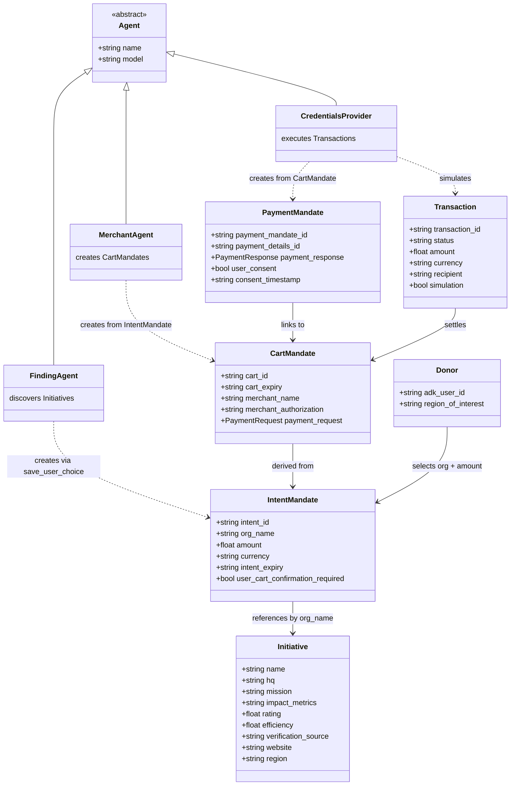

---
blueprint:
  type: domain
  id: art_domain
  version: 1
  status: in_review
  inputs:
    artifacts:
      - { id: art_requirements, version: 1 }
  evidence:
    - "afara-dada-code-agents/femtech_empowerment_funding_advisor/data/femtech_programs.py — Initiative attributes and region taxonomy"
    - "afara-dada-code-agents/femtech_empowerment_funding_advisor/tools/femtechorgs_tools.py — IntentMandate creation fields"
    - "afara-dada-code-agents/femtech_empowerment_funding_advisor/tools/merchant_tools.py — CartMandate structure and signature"
    - "afara-dada-code-agents/femtech_empowerment_funding_advisor/tools/payment_tools.py — PaymentMandate structure and Transaction result"
    - "afara-dada-code-agents/femtech_empowerment_funding_advisor/credentials_provider/agent.py:69-73 — the three-credential chain description"
  guesses:
    - "Donor identity is anonymous: no user account or profile entity exists in the code; only an ADK user_id string (see Q-05)"
    - "Organization names are the de-facto registry identifiers (no EIN/registration number is used; see Q-03)"
---

# Domain model — Afara Dada Code

## Glossary

- **Donor** — the human user (individual, corporate, or DAO representative) who wants to fund an initiative. Identified only by an ADK `user_id`; no account system exists.
- **Initiative** (Organization) — a vetted African female tech empowerment organization (e.g., She Code Africa, Pwani Teknowgalz) from the curated dataset, with trust metrics: HQ, mission, impact metrics, rating, efficiency (fraction of funds going to programs), verification source.
- **Verification Source** — the third-party credential backing an initiative's legitimacy (e.g., "Registered Non-Profit; Partnered with Grow with Google & FedEx").
- **Region** — the discovery taxonomy for initiatives: `pan-africa`, `east-africa`, `global-diaspora`; the special value `africa` returns all.
- **AP2** — Google's Agentic Payments Protocol (library `google-agentic/AP2`), which defines the three verifiable credentials used here.
- **IntentMandate** — first credential: the donor's verified *desire* to fund a specific organization with a specific USD amount. Valid 1 hour. ID format `fund_<NAME>_<unix-ts>`.
- **CartMandate** — second credential: the organization's binding *offer* to accept the funds, structured as a W3C PaymentRequest and signed (hash-based). Valid 15 minutes. ID format `cart_<hash12>`.
- **Merchant/organization signature** — a SHA-256 hash over the canonical JSON of the cart contents, formatted `SIG_<hash16>`. A simulation of a real cryptographic commitment.
- **PaymentMandate** — third credential: the authorization to *execute* the transfer, linking back to the CartMandate and recording user consent. ID format `payment_<hash12>`.
- **Transaction** — the (simulated) result of executing a PaymentMandate: transaction ID `txn_<hash16>`, status `completed`, amount, currency, recipient, `simulation: true`.
- **Agents**:
  - **Root agent / AfaraTechAdvisor** — the conversational orchestrator donors talk to; routes between discovery and execution phases.
  - **Finding Agent** — discovery and trust analysis; presents verified initiatives and creates the IntentMandate.
  - **Merchant Agent** — transaction specialist; converts an IntentMandate into a signed CartMandate.
  - **Credentials Provider** — payment processor; obtains consent, creates the PaymentMandate, and simulates the transfer.
  - **Naive Agent** — a comparison baseline that uses open Google Search instead of the trusted dataset.
- **Shared state** — the ADK session state (`tool_context.state`), the only channel through which the mandate chain flows between agents.
- **Trust layer** — the project's core value proposition: only curated, verified organizations are surfaced, as opposed to open-web discovery.

## Notes

- The mandate chain is intentionally linear: Intent → Cart → Payment, each stage re-validating the previous stage's expiry. `credentials_provider/agent.py:69-73` describes it as an "auditable chain of trust."
- The `Donor` and `Initiative` link is by organization *name* string, not by a stable registry ID — `_create_intent_mandate` (`femtechorgs_tools.py:88-90`) derives a mock registration ID from the name itself.
