---
blueprint:
  type: domain
  id: art_domain
  version: 1
  status: in_review
  inputs:
    artifacts:
      - { id: art_requirements, version: 1 }
  evidence:
    - "afara-dada-code-agents/femtech_empowerment_funding_advisor/data/femtech_programs.py: initiative fields (name, hq, mission, impact_metrics, rating, efficiency, verification_source, website) grouped by region"
    - "afara-dada-code-agents/femtech_empowerment_funding_advisor/tools/femtechorgs_tools.py:79-113: IntentMandate fields plus the custom timestamp, intent_id, org_name, amount, currency"
    - "afara-dada-code-agents/femtech_empowerment_funding_advisor/tools/merchant_tools.py:111-165: CartMandate, CartContents, PaymentRequest, PaymentItem, PaymentCurrencyAmount, PaymentMethodData"
    - "afara-dada-code-agents/femtech_empowerment_funding_advisor/tools/payment_tools.py:48-147: PaymentMandate, PaymentMandateContents, PaymentResponse, payment_result"
    - "afara-dada-code-agents/femtech_empowerment_funding_advisor/credentials_provider/agent.py:69-74: description of the three-credential AP2 chain"
  guesses:
    - "An Initiative is identified only by its name. The upper-cased, alphanumeric-only name stands in for a registration number ('mock_reg_id'), and no real registry ID exists (see Q-06)"
    - "A donor is an anonymous session user. The code has no donor entity, identity or KYC (see Q-05)"
    - "Organisations will not hold signing keys, so the 'signature' is a content hash, not a cryptographic signature (see Q-04)"
---

# Afara Dada Code – Domain Model

```mermaid
classDiagram
    direction LR

    class Donor {
      <<session user>>
      user_id
    }
    class Region {
      <<enum key>>
      pan-africa
      east-africa
      global-diaspora
      africa (all)
    }
    class Initiative {
      name
      hq
      mission
      impact_metrics
      rating : float
      efficiency : float
      verification_source
      website
    }
    class SessionState {
      intent_mandate : dict
      cart_mandate : dict
      payment_mandate : dict
      payment_result : dict
    }
    class IntentMandate {
      <<AP2>>
      user_cart_confirmation_required = true
      natural_language_description
      merchants : list~str~
      skus = None
      requires_refundability = false
      intent_expiry (now + 1h)
      +intent_id : fund_REGID_epoch
      +org_name
      +amount : float
      +currency = USD
      +timestamp
    }
    class CartMandate {
      <<AP2>>
      merchant_authorization : SIG_hash16
      +timestamp
    }
    class CartContents {
      <<AP2>>
      id : cart_hash12
      cart_expiry (now + 15m)
      merchant_name
      user_cart_confirmation_required = false
    }
    class PaymentRequest {
      <<W3C>>
    }
    class PaymentMethodData {
      supported_methods = CARD
      data : visa/mastercard, debit/credit
    }
    class PaymentDetailsInit {
      id : order_cartid
    }
    class PaymentItem {
      label
    }
    class PaymentCurrencyAmount {
      currency = USD
      value : float
    }
    class PaymentMandate {
      <<AP2>>
      +agent_present = true
    }
    class PaymentMandateContents {
      <<AP2>>
      payment_mandate_id : payment_hash12
      payment_details_id = cart id
      merchant_agent = org name
      timestamp
      +user_consent : bool
      +consent_timestamp
    }
    class PaymentResponse {
      <<W3C>>
      request_id = cart id
      method_name = CARD
      details.token (simulated)
    }
    class PaymentResult {
      transaction_id : txn_hash16
      status = completed
      amount
      currency
      recipient
      simulation = true
    }

    Region "1" o-- "*" Initiative : groups
    Donor "1" -- "1" SessionState : owns
    Donor ..> Initiative : selects + amount
    IntentMandate ..> Initiative : merchants[0] / org_name (by name)
    SessionState o-- IntentMandate
    SessionState o-- CartMandate
    SessionState o-- PaymentMandate
    SessionState o-- PaymentResult
    CartMandate ..> IntentMandate : derived from
    CartMandate *-- CartContents
    CartContents *-- PaymentRequest
    PaymentRequest *-- "1..*" PaymentMethodData
    PaymentRequest *-- PaymentDetailsInit
    PaymentDetailsInit *-- "1..*" PaymentItem : display_items
    PaymentDetailsInit *-- PaymentItem : total
    PaymentItem *-- PaymentCurrencyAmount
    PaymentMandate *-- PaymentMandateContents
    PaymentMandateContents ..> CartMandate : payment_details_id
    PaymentMandateContents *-- PaymentItem : payment_details_total
    PaymentMandateContents *-- PaymentResponse
    PaymentResult ..> PaymentMandate : produced with
```

Fields marked `+` are custom fields the code adds to the AP2 model after `model_dump()`. They are not part of
the AP2 schema.

## Glossary

| Term | Meaning in this system | Source |
|------|------------------------|--------|
| **Afara Dada Code / Afara Tech** | The product, and the persona of the root advisor agent (`AfaraTechAdvisor`). | `README.md`, `agent.py:26-31` |
| **Donor** | The person talking to the agent. The README says donors can be individuals, corporates or DAOs. In code a donor is just an ADK `user_id`. | `README.md:15`, `scripts/test_merchant.py:30` |
| **Initiative / Organisation / "Merchant"** | A vetted African female tech empowerment organisation that receives funds, such as She Code Africa. AP2 calls the recipient the "merchant". | `data/femtech_programs.py` |
| **Region** | The key used to look up initiatives: `pan-africa`, `east-africa`, `global-diaspora`, or `africa` for all of them. | `data/femtech_programs.py:10-76` |
| **Trusted Data Layer / Trust Verification Layer** | The curated, in-code directory of vetted initiatives, used instead of the open web. | `data/femtech_programs.py:2-3`, `finding_agent/agent.py:2-3` |
| **Verification source** | Free text naming who vouches for an initiative (a registration, partner or award). It is shown to donors but not checked. | `data/femtech_programs.py` |
| **Efficiency** | The share of funds said to go straight to programmes (0–1), shown as a percentage. | `data/femtech_programs.py:18`, `tools/femtechorgs_tools.py:170` |
| **Rating** | A score out of 5.0 for each initiative. Its source is not documented. | `data/femtech_programs.py` |
| **AP2** | Agent Payments Protocol (`google-agentic-commerce/AP2`). It supplies the Pydantic mandate and payment-request types. | `requirements.txt:3` |
| **Mandate** | A verifiable credential in the AP2 chain. The three are Intent, then Cart, then Payment. | `credentials_provider/agent.py:69-74` |
| **IntentMandate ("Trust Packet", "funding packet")** | The donor's stated wish to fund one organisation with a given amount. It expires after 1 hour. | `tools/femtechorgs_tools.py:79-113` |
| **Intent ID** | `fund_<first 10 alphanumerics of org name, upper-cased>_<unix seconds>`. | `tools/femtechorgs_tools.py:90,107` |
| **CartMandate ("funding contract", "offer")** | The organisation's binding offer to accept the amount, written as a W3C PaymentRequest. It expires after 15 minutes. | `tools/merchant_tools.py:77-175` |
| **Merchant authorization / Organisation signature** | `SIG_` followed by the first 16 hex characters of the SHA-256 of the canonical CartContents JSON. It is simulated and uses no key. | `tools/merchant_tools.py:54-74` |
| **PaymentMandate** | The final credential. It authorises the transfer, links to the cart, and records consent. | `tools/payment_tools.py:48-92` |
| **Payment result / Transaction** | The simulated settlement record with its `txn_` ID. | `tools/payment_tools.py:134-143` |
| **Two-turn conversational confirmation** | The prompt-level rule that the credentials provider must ask "Do you want to proceed?" and wait for a yes before paying. | `credentials_provider/agent.py:33-39` |
| **FundingProcessingPipeline** | The fixed sequence of the merchant agent followed by the credentials provider. | `agent.py:14-21` |
| **Naive Agent** | A demo agent that searches the open web with no trust layer. It stands for the problem the product solves. | `Naive_Agent/agent.py` |
| **Phase 1 / Phase 2** | Discovery & Trust (finding agent), then Secure Execution (pipeline). | `agent.py:35-58` |

## Notes

- Initiatives are linked to mandates **by name only**. Nothing checks that `org_name` in the IntentMandate is in
  the vetted directory (see Q-01).
- All money is a USD `float`. No other currency or decimal type is used.
- The code has no persisted entity. Everything lives in ADK session state, and the only session service shown
  in the code is `InMemorySessionService`, used in the test script.
