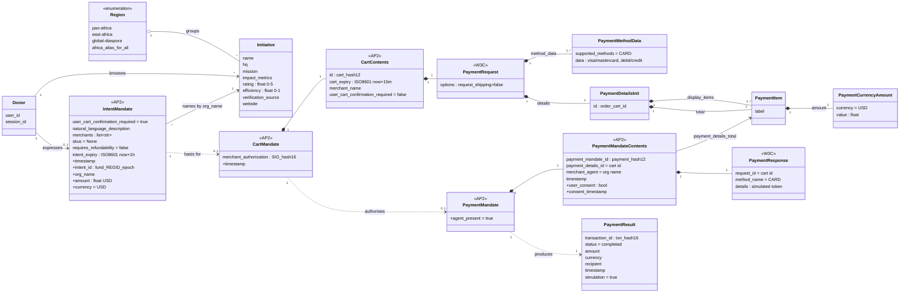

---
blueprint:
  type: domain
  id: art_domain
  version: 1
  status: in_review
  inputs:
    artifacts:
      - { id: art_requirements, version: 1 }
  evidence:
    - "afara-dada-code-agents/femtech_empowerment_funding_advisor/data/femtech_programs.py: Initiative fields (name, hq, mission, impact_metrics, rating, efficiency, verification_source, website) grouped by region key"
    - "afara-dada-code-agents/femtech_empowerment_funding_advisor/tools/femtechorgs_tools.py:79-113: IntentMandate fields plus extensions (timestamp, intent_id, org_name, amount, currency)"
    - "afara-dada-code-agents/femtech_empowerment_funding_advisor/tools/merchant_tools.py:116-165: CartMandate / CartContents / PaymentRequest / PaymentItem / PaymentCurrencyAmount / PaymentMethodData construction"
    - "afara-dada-code-agents/femtech_empowerment_funding_advisor/tools/payment_tools.py:48-147: PaymentMandate / PaymentMandateContents / PaymentResponse and payment_result dict"
    - "afara-dada-code-agents/femtech_empowerment_funding_advisor/credentials_provider/agent.py:69-74: description of the AP2 credential chain"
  guesses:
    - "An Initiative is the same thing as the AP2 'merchant'. It is identified only by its name; there is no stable organisation ID (see Q-02, Q-04)"
    - "A Donor is an anonymous ADK session user with no account or profile (see Q-08)"
    - "One session holds at most one active IntentMandate, CartMandate and PaymentMandate, because each state key is overwritten (see Q-10)"
---

# Domain model

Notes

- Attributes marked `+` are **extensions** that this code adds to the AP2 model when it converts the model to a
  state dict (`femtechorgs_tools.py:104-111`, `merchant_tools.py:163`, `payment_tools.py:88-90`). They are not part of
  the AP2 schema, and when a later step re-validates the mandate with `model_validate` they are dropped or ignored.
- Mandates are not linked by a typed foreign key. The cart is derived from the intent's `merchants[0]` and the
  extension field `amount` (`merchant_tools.py:113-114`). The payment mandate refers to the cart through
  `payment_details_id` and `PaymentResponse.request_id` (`payment_tools.py:63-73`).
- `PaymentResult` is a plain dict, not an AP2 type (`payment_tools.py:135-143`).

## Glossary

| Term | Meaning in this system | Source |
|------|------------------------|--------|
| **Afara Dada Code / Afara Tech** | The product. "Afara Tech" (agent name `AfaraTechAdvisor`) is the persona of the root conversational advisor. | `README.md`, `agent.py:26-31` |
| **Donor** | A person or body (the README names individuals, corporates and DAOs) who wants to fund an initiative. In code, an ADK `user_id` with a session. | `README.md:15`, `scripts/test_merchant.py:30` |
| **Initiative / Organisation** | A vetted African female-in-tech empowerment organisation that can receive funds (She Code Africa, Women in Tech Africa, Pwani Teknowgalz, Tambua Women in Tech, Empower Her Community). | `data/femtech_programs.py:10-67` |
| **Merchant** | The AP2 / payments word for the initiative receiving funds. `merchants`, `merchant_name` and `merchant_agent` all hold the organisation name. | `merchant_tools.py:113,147`, `payment_tools.py:75` |
| **Region** | Key used to group initiatives: `pan-africa`, `east-africa`, `global-diaspora`. The special value `africa` returns all of them. | `data/femtech_programs.py:10-76` |
| **Trust metrics** | The fields shown to build donor confidence: Verification Source, Rating (out of 5), Efficiency (share of funds going to programmes), Impact metrics. | `femtechorgs_tools.py:157-182` |
| **Verification Source** | Free-text statement of who vouches for an organisation (e.g. "Awarded by Technovation"). Not checked automatically. | `data/femtech_programs.py` |
| **Efficiency** | Fraction (0-1) of donated funds said to go directly to programmes, shown as a percentage. | `data/femtech_programs.py:18`, `femtechorgs_tools.py:170` |
| **Trusted Data Layer / Trust Layer** | The curated initiative list, used instead of open-web search, which the product presents as its main value. | `data/femtech_programs.py:1-4`, `Naive_Agent/agent.py:10-11` |
| **Funding packet / Trust packet** | Informal names for the IntentMandate created from the donor's choice. | `femtechorgs_tools.py:151`, `finding_agent/agent.py:47` |
| **AP2 (Agent Payments Protocol)** | Google's agentic-commerce protocol, whose Pydantic types (`ap2.types.mandate`, `ap2.types.payment_request`) model the three-credential chain. | `requirements.txt:3`, `tools/*.py` imports |
| **IntentMandate** | Credential 1: records that the donor wants to fund a named organisation with an amount. Valid for 1 hour. | `femtechorgs_tools.py:79-113` |
| **CartMandate** | Credential 2: the organisation's binding offer to accept the amount, written as a W3C PaymentRequest and "signed". Valid for 15 minutes. | `merchant_tools.py:77-175` |
| **CartContents** | The signed body of a CartMandate: id, expiry, merchant name, payment request. | `merchant_tools.py:144-150` |
| **Merchant authorisation / Organisation signature** | `SIG_` + first 16 hex characters of the SHA-256 of the canonical CartContents JSON. Simulated and unkeyed. | `merchant_tools.py:54-74` |
| **PaymentRequest (W3C)** | Standard structure listing accepted payment methods (CARD: visa/mastercard, debit/credit), line items and total. | `merchant_tools.py:122-142` |
| **PaymentMandate** | Credential 3: authorises execution. Links to the cart and records consent, the payment response (simulated token) and the merchant. | `payment_tools.py:48-92` |
| **Consent** | The donor's explicit "yes" before payment. Asked for in the prompt; the stored `user_consent` flag is always `true`. | `credentials_provider/agent.py:33-39`, `payment_tools.py:128` |
| **Transaction / Payment result** | Outcome of the simulated transfer: `txn_` ID, status `completed`, `simulation: true`. | `payment_tools.py:134-143` |
| **Intent ID** | `fund_<REGID>_<unix-seconds>`, where REGID is the organisation name with non-word characters removed, upper-cased and cut to 10 characters (a stand-in for a registration number / EIN). | `femtechorgs_tools.py:88-90,107` |
| **Finding Agent** | LLM sub-agent for discovery and intent creation. | `finding_agent/agent.py` |
| **Merchant Agent** | LLM sub-agent that turns an intent into a signed cart ("Contract Creator"). | `merchant_agent/agent.py` |
| **Credentials Provider** | LLM sub-agent that gets consent and creates the PaymentMandate ("Payment Processor"). The prompts also call it the "Payment Agent". | `credentials_provider/agent.py` |
| **Funding Processing Pipeline** | ADK `SequentialAgent` that runs the Merchant Agent and then the Credentials Provider. | `agent.py:14-21` |
| **Naive Agent** | Baseline agent that uses open-web Google Search with no trust layer, to show the "before" state. | `Naive_Agent/agent.py` |
| **Session state** | ADK per-session key/value store, the only channel between agents (`intent_mandate`, `cart_mandate`, `payment_mandate`, `payment_result`). | `tools/*.py` |
