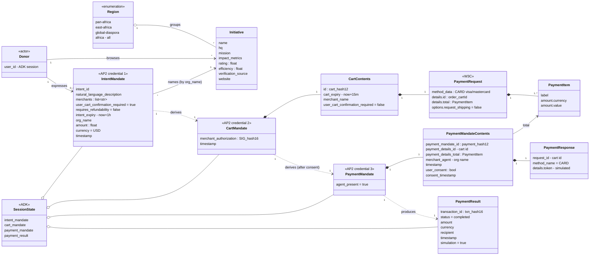

---
blueprint:
  type: domain
  id: art_domain
  version: 1
  status: in_review
  inputs:
    artifacts:
      - { id: art_requirements, version: 1 }
  evidence:
    - "afara-dada-code-agents/femtech_empowerment_funding_advisor/data/femtech_programs.py: Initiative fields (name, hq, mission, impact_metrics, rating, efficiency, verification_source, website) grouped by region"
    - "afara-dada-code-agents/femtech_empowerment_funding_advisor/tools/femtechorgs_tools.py: IntentMandate construction plus extension fields intent_id, org_name, amount, currency, timestamp"
    - "afara-dada-code-agents/femtech_empowerment_funding_advisor/tools/merchant_tools.py: CartMandate / CartContents / PaymentRequest construction and merchant signature"
    - "afara-dada-code-agents/femtech_empowerment_funding_advisor/tools/payment_tools.py: PaymentMandate / PaymentMandateContents / PaymentResponse and payment_result"
    - "afara-dada-code-agents/femtech_empowerment_funding_advisor/credentials_provider/agent.py: description of the three-credential AP2 chain"
  guesses:
    - "Field lists for the AP2 types are limited to what the code sets or reads; the upstream AP2 models may have more fields (see Q-09)"
    - "A Donor is identified only by the ADK session user_id; there is no Donor record in the code (see Q-07)"
    - "'Merchant' in AP2 terms is the same entity as the recipient Initiative; the code links them by name only (see Q-04)"
---

# Domain model: FemTech Empowerment Funding

## Notes

- **The mandate chain lives only in the ADK session state.** It is stored as JSON-serialisable dicts. Each tool reads the previous credential back from state and re-validates it with the AP2 Pydantic model (`merchant_tools.py:90-103`, `payment_tools.py:105-115`). No mandate holds a hash or pointer to the one before it. A PaymentMandate refers to its cart by `payment_details_id` (the cart id). A CartMandate refers to its intent only through the copied organisation name and amount.
- **Initiatives are identified by display name.** They have no stable id. `_create_intent_mandate` builds a "mock registration id" from the name (`femtechorgs_tools.py:88-90`), and that id appears only inside `intent_id`.
- **Amounts are floats** throughout: the `amount` argument, `PaymentCurrencyAmount.value` and `payment_result.amount`.

## Glossary

| Term | Meaning in this system | Source |
|------|------------------------|--------|
| **Afara Dada Code** | Product name. Roughly "bridge for sisters"; an AI intermediary that connects donors to verified female tech empowerment organisations. | `README.md:3-17` |
| **Afara Tech / AfaraTechAdvisor** | Persona and agent name of the root orchestrator that donors talk to. | `agent.py:26-31` |
| **Donor** | Person or organisation (individual, corporate, DAO) that wants to fund an initiative. In code, only the ADK `user_id` stands for the donor. | `README.md:15`, `scripts/test_merchant.py:30` |
| **Initiative / Organisation** | A vetted African female tech empowerment organisation, e.g. She Code Africa or Pwani Teknowgalz. Acts as the "merchant" in AP2 terms. | `data/femtech_programs.py:11-67` |
| **Region** | Registry key used to group initiatives: `pan-africa`, `east-africa`, `global-diaspora`. The keyword `africa` returns every initiative. | `data/femtech_programs.py:11-76` |
| **Trusted Data Layer / Trust Layer** | The curated registry of vetted organisations, as opposed to open-web search. It is the system's core value proposition. | `data/femtech_programs.py:1-4`, `Naive_Agent/agent.py:10-11` |
| **Verification source** | Free-text evidence of an organisation's legitimacy (e.g. "Awarded by Technovation"). Shown to donors as "Verified By". | `data/femtech_programs.py:19`, `tools/femtechorgs_tools.py:167` |
| **Efficiency** | Share of funds that go directly to programmes (0–1), shown as a percentage. | `data/femtech_programs.py:18`, `tools/femtechorgs_tools.py:170` |
| **Rating** | Score from 0 to 5 for an initiative. Its source is not stated. | `data/femtech_programs.py:17` |
| **Impact metrics** | Free-text summary of results (e.g. "62,000+ women trained"). | `data/femtech_programs.py:16` |
| **AP2** | Agent Payments Protocol (google-agentic-commerce/AP2). Supplies the Pydantic mandate types. | `requirements.txt:3` |
| **Mandate** | A verifiable credential in AP2. This system issues three, in order: Intent, Cart, Payment. | `credentials_provider/agent.py:69-74` |
| **IntentMandate** | Credential 1: the donor's stated intent to fund one named organisation with an amount. Valid for 1 hour. Also called the "Trust Packet" or "funding packet". | `tools/femtechorgs_tools.py:79-113`, `finding_agent/agent.py:47` |
| **CartMandate** | Credential 2: the organisation's binding offer to accept the amount, built as a W3C PaymentRequest and signed. Valid for 15 minutes. Also called the "funding contract" or "offer". | `tools/merchant_tools.py:77-175` |
| **Merchant authorization / Organisation signature** | Simulated signature `SIG_<first 16 hex of SHA-256>` over the canonical cart-contents JSON. | `tools/merchant_tools.py:54-74` |
| **PaymentMandate** | Credential 3: authorises execution. Links to the cart and records consent and the (simulated) payment response. | `tools/payment_tools.py:48-92` |
| **Payment result / Transaction** | Outcome record of the simulated transfer, with a `txn_…` id and `simulation: true`. | `tools/payment_tools.py:134-143` |
| **Two-turn confirmation** | Conversation pattern: the agent asks "Do you want to proceed…?" and pays only after the donor's next message confirms. | `credentials_provider/agent.py:33-39` |
| **FundingProcessingPipeline** | ADK SequentialAgent that runs MerchantAgent and then CredentialsProvider. | `agent.py:14-21` |
| **Finding Agent** | Discovery and trust analyst. Queries the registry and creates the IntentMandate. | `finding_agent/agent.py` |
| **Merchant Agent** | "Contract creator". Turns the intent into a signed CartMandate. | `merchant_agent/agent.py` |
| **Credentials Provider** | "Payment processor". Gets consent and creates the PaymentMandate and transaction. | `credentials_provider/agent.py` |
| **Naive Agent** | Baseline "before" agent that uses open-web Google Search and has no verification. | `Naive_Agent/agent.py` |
| **Session state** | ADK per-session key/value store that agents share through `tool_context.state`. | `tools/*.py` |
