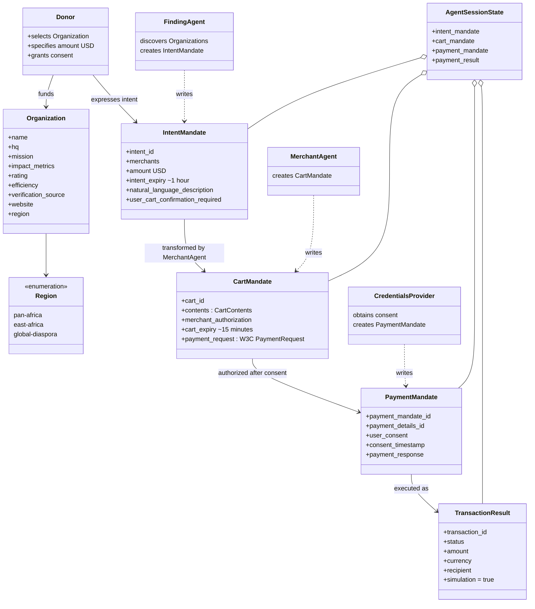

---
blueprint:
  type: domain
  id: art_domain
  version: 1
  status: in_review
  inputs:
    artifacts:
      - { id: art_requirements, version: 1 }
  evidence:
    - "afara-dada-code-agents/femtech_empowerment_funding_advisor/agent.py — agent roles and the IntentMandate → CartMandate → PaymentMandate chain described in instructions"
    - "afara-dada-code-agents/femtech_empowerment_funding_advisor/data/femtech_programs.py — Initiative attributes (name, hq, mission, impact_metrics, rating, efficiency, verification_source, website)"
    - "afara-dada-code-agents/femtech_empowerment_funding_advisor/tools/femtechorgs_tools.py, merchant_tools.py, payment_tools.py — mandate structures and state keys"
  guesses:
    - "\"Donor\" is used for the human user even though the code never names them; the agents' instructions address a funding user (see Q-06)."
    - "Region taxonomy is fixed to the three keys in femtech_programs.py; free-text regions other than 'africa' return nothing (see Q-08)."
---

# Domain Model — Afara Dada Code

## Glossary

- **Donor** — the human user (individual, corporate or DAO in the README's vision) who wants to fund women-in-tech initiatives in Africa.
- **Organization / Initiative** — a vetted African female tech empowerment entity in the curated database (e.g., She Code Africa, Pwani Teknowgalz), carrying trust metrics: rating (out of 5), efficiency (share of funds reaching programs), impact metrics and a verification source.
- **Verification Source** — the external endorsement cited as proof an organization is legitimate (e.g., "Registered Non-Profit; Partnered with Grow with Google").
- **Region** — the search taxonomy for organizations: `pan-africa`, `east-africa`, `global-diaspora`; the special value `africa` means "all regions".
- **AP2** — the Agentic Commerce Protocol library (`google-agentic-commerce/AP2`) whose Pydantic models define the three mandate credentials.
- **IntentMandate** — AP2 verifiable credential proving the donor's intent to fund a specific organization for a specific amount; valid 1 hour. Created by the Finding Agent.
- **CartMandate** — AP2 verifiable credential that converts intent into the organization's binding, signed offer (a "contract") with a W3C PaymentRequest; valid 15 minutes. Created by the Merchant Agent.
- **PaymentMandate** — AP2 verifiable credential that authorizes execution, linking to the CartMandate and recording user consent. Created by the Credentials Provider.
- **Merchant Signature** — a simulated commitment string `SIG_<sha256(cart contents)[:16]>` attached to a CartMandate; not a keyed cryptographic signature.
- **W3C PaymentRequest** — the standard payment-description structure (method data, display items, total) embedded in a CartMandate.
- **Agent (ADK)** — a Google Agent Development Kit `Agent` with a model, instruction and tools; agents here are specialists with strict boundaries.
- **Root Orchestrator (AfaraTechAdvisor)** — the top-level agent users talk to; it delegates to the Finding Agent and to the FundingProcessingPipeline.
- **FundingProcessingPipeline** — an ADK `SequentialAgent` running Merchant Agent → Credentials Provider, in that order, after an initiative is selected.
- **Finding Agent** — the "Trust Verification Layer": searches the curated database and creates the IntentMandate.
- **Merchant Agent** — the "Contract Creator": converts an IntentMandate into a signed CartMandate.
- **Credentials Provider** — the "Payment Processor": obtains explicit consent and creates the PaymentMandate plus a simulated transfer.
- **Agent Session State** — the shared ADK session dictionary through which the three credentials and the payment result are handed between agents (`intent_mandate`, `cart_mandate`, `payment_mandate`, `payment_result` keys).
- **Naive Agent** — a deliberately unverified open-web-search agent kept as a demo contrast to the trust-layered pipeline.
- **Transaction Result** — the outcome record of a (simulated) transfer, with a unique `txn_...` ID.
