---
blueprint:
  type: domain
  id: art_domain
  version: 1
  status: in_review
  inputs:
    artifacts:
      - { id: art_requirements, version: 1 }
  evidence:
    - "afara-dada-code-agents/femtech_empowerment_funding_advisor/data/femtech_programs.py: Initiative record fields and region keys"
    - "afara-dada-code-agents/femtech_empowerment_funding_advisor/tools/femtechorgs_tools.py: IntentMandate fields plus custom intent_id/org_name/amount/currency/timestamp"
    - "afara-dada-code-agents/femtech_empowerment_funding_advisor/tools/merchant_tools.py: CartMandate, CartContents, PaymentRequest and child AP2 types"
    - "afara-dada-code-agents/femtech_empowerment_funding_advisor/tools/payment_tools.py: PaymentMandate, PaymentMandateContents, PaymentResponse, payment_result dict"
    - "afara-dada-code-agents/femtech_empowerment_funding_advisor/credentials_provider/agent.py: description of the three-credential AP2 chain"
  guesses:
    - "Initiative.name is the de-facto identity key; no registration number exists (code derives a mock reg id from the name) (see Q-03)"
    - "Field lists of AP2 types are limited to what this code sets/reads; the AP2 library may define more (see Q-07)"
    - "The Donor has no persisted identity beyond the ADK session user_id (see Q-01)"
---

# Domain Model

```mermaid
classDiagram
    direction LR

    class Donor {
        +String user_id
        +String session_id
    }
    class Region {
        +String key
    }
    class Initiative {
        +String name
        +String hq
        +String mission
        +String impact_metrics
        +float rating
        +float efficiency
        +String verification_source
        +String website
    }
    class IntentMandate {
        +bool user_cart_confirmation_required
        +String natural_language_description
        +List~String~ merchants
        +List skus
        +bool requires_refundability
        +String intent_expiry
        +String intent_id
        +String org_name
        +float amount
        +String currency
        +String timestamp
    }
    class CartMandate {
        +CartContents contents
        +String merchant_authorization
        +String timestamp
    }
    class CartContents {
        +String id
        +String cart_expiry
        +String merchant_name
        +bool user_cart_confirmation_required
    }
    class PaymentRequest {
        +PaymentOptions options
    }
    class PaymentMethodData {
        +String supported_methods
        +dict data
    }
    class PaymentDetailsInit {
        +String id
    }
    class PaymentItem {
        +String label
    }
    class PaymentCurrencyAmount {
        +String currency
        +float value
    }
    class PaymentMandate {
        +bool agent_present
    }
    class PaymentMandateContents {
        +String payment_mandate_id
        +String payment_details_id
        +String merchant_agent
        +String timestamp
        +bool user_consent
        +String consent_timestamp
    }
    class PaymentResponse {
        +String request_id
        +String method_name
        +dict details
    }
    class PaymentResult {
        +String transaction_id
        +String status
        +float amount
        +String currency
        +String recipient
        +String timestamp
        +bool simulation
    }
    class SessionState {
        +dict intent_mandate
        +dict cart_mandate
        +dict payment_mandate
        +dict payment_result
    }

    Region "1" o-- "0..*" Initiative : groups
    Donor "1" --> "0..*" IntentMandate : expresses
    IntentMandate "1" --> "1" Initiative : merchants[0] names
    CartMandate "1" ..> "1" IntentMandate : derived from
    CartMandate "1" *-- "1" CartContents
    CartContents "1" *-- "1" PaymentRequest
    PaymentRequest "1" *-- "1..*" PaymentMethodData : method_data
    PaymentRequest "1" *-- "1" PaymentDetailsInit : details
    PaymentDetailsInit "1" *-- "1..*" PaymentItem : display_items
    PaymentDetailsInit "1" *-- "1" PaymentItem : total
    PaymentItem "1" *-- "1" PaymentCurrencyAmount : amount
    PaymentMandate "1" *-- "1" PaymentMandateContents
    PaymentMandateContents "1" *-- "1" PaymentResponse
    PaymentMandateContents "1" --> "1" PaymentItem : payment_details_total
    PaymentMandateContents "1" ..> "1" CartMandate : payment_details_id = cart id
    PaymentResult "1" ..> "1" CartMandate : txn hash of cart id
    SessionState "1" o-- "0..1" IntentMandate
    SessionState "1" o-- "0..1" CartMandate
    SessionState "1" o-- "0..1" PaymentMandate
    SessionState "1" o-- "0..1" PaymentResult
```

## Glossary

| Term | Meaning in this system | Source |
|------|------------------------|--------|
| **Donor** | The person or entity talking to the advisor who wants to fund an initiative. The README names individuals, corporates and DAOs. In code the donor is only an ADK session `user_id`. | `README.md:15`, `scripts/test_merchant.py:30` |
| **Initiative / Organisation** | A vetted African female tech-empowerment organisation, such as She Code Africa or Pwani Teknowgalz. AP2 calls it the **merchant**. | `data/femtech_programs.py` |
| **Region** | Grouping key for initiatives: `pan-africa`, `east-africa`, `global-diaspora`. The pseudo-region `africa` means all of them. | `data/femtech_programs.py:11,33,55,70` |
| **Trusted Data Layer / Registry** | The hard-coded, curated list of 5 initiatives. It is the only source the Finding Agent may use. | `data/femtech_programs.py:1-4` |
| **Verification Source** | A free-text statement of why an initiative is credible, for example "Awarded by Technovation". It is shown to the donor as proof of legitimacy. | `data/femtech_programs.py`, `finding_agent/agent.py:28` |
| **Efficiency** | Share of funds that goes directly to programmes (0 to 1). It is displayed as a percentage. | `data/femtech_programs.py:18`, `tools/femtechorgs_tools.py:170` |
| **Rating** | A score out of 5.0 for an initiative. The code does not say where the score comes from. | `data/femtech_programs.py` |
| **Impact Metrics** | Free-text outcomes, for example "6,800+ girls empowered". | `data/femtech_programs.py` |
| **AP2** | Agent Payments Protocol (github.com/google-agentic-commerce/AP2). It supplies the Pydantic mandate and payment-request types. | `requirements.txt:3` |
| **Mandate** | A verifiable credential in AP2. This system chains three of them. | `credentials_provider/agent.py:69-74` |
| **IntentMandate** | Credential 1: the donor's recorded intent to fund one initiative with an amount in USD. It is valid for 1 hour. The README also calls it the "Trust Packet" or "funding packet". | `tools/femtechorgs_tools.py:79-113` |
| **Intent ID** | `fund_<MOCKREGID>_<epoch>`, the identifier the root agent watches for before moving to the payment phase. | `tools/femtechorgs_tools.py:107`, `agent.py:47` |
| **CartMandate** | Credential 2: the organisation's binding offer, also called the "funding contract", to accept the amount. It holds a W3C PaymentRequest and is valid for 15 minutes. | `tools/merchant_tools.py:77-175` |
| **Merchant Authorization / Organisation Signature** | `SIG_<16 hex>`, a SHA-256 hash of the cart contents. It stands in for a cryptographic signature but uses no key. | `tools/merchant_tools.py:54-74` |
| **W3C PaymentRequest** | The standard structure inside the cart: method data, details (display items and total) and options. | `tools/merchant_tools.py:122-142` |
| **PaymentMandate** | Credential 3: authorisation to execute the payment. It links to the cart and records consent. | `tools/payment_tools.py:48-92` |
| **User Consent** | The donor's explicit "yes" before funds move. The LLM asks for it, but the tool hard-codes `consent_granted = True`. | `credentials_provider/agent.py:33-39`, `tools/payment_tools.py:128` |
| **Payment Result / Transaction** | The record of the simulated transfer, `txn_<16 hex>` with `simulation: true`. | `tools/payment_tools.py:134-143` |
| **Funding Processing Pipeline** | The ADK `SequentialAgent` that runs Merchant Agent and then Credentials Provider. | `agent.py:14-21` |
| **Shared / Session State** | The ADK session state dictionary that agents use to hand off mandates. | `tools/*.py` (`tool_context.state`) |
| **Naive Agent** | The baseline "before" agent that searches the open web with no trust layer. | `Naive_Agent/agent.py` |

## Notes

- The domain uses AP2's commerce words ("merchant", "cart") for a donation flow. A *merchant* here is a non-profit initiative and a *cart* is a single donation line.
- The IntentMandate is stored as an AP2 model dump plus custom keys (`intent_id`, `org_name`, `amount`, `currency`, `timestamp`). The amount is **not** part of the AP2 IntentMandate type: the Merchant Agent reads it from the raw dictionary (`merchant_tools.py:114`).
- No relationship ties an IntentMandate to a registry entry by ID. The link is only the organisation name string, and the name is never checked against the registry (see Q-03).
